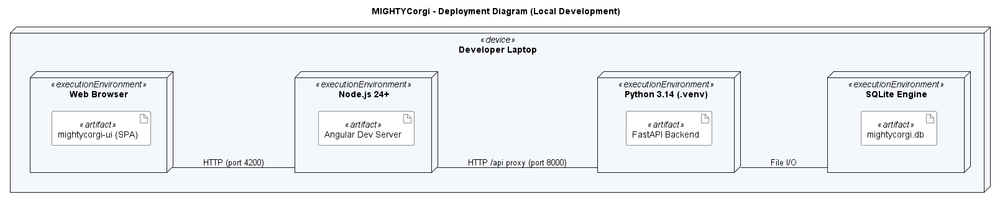
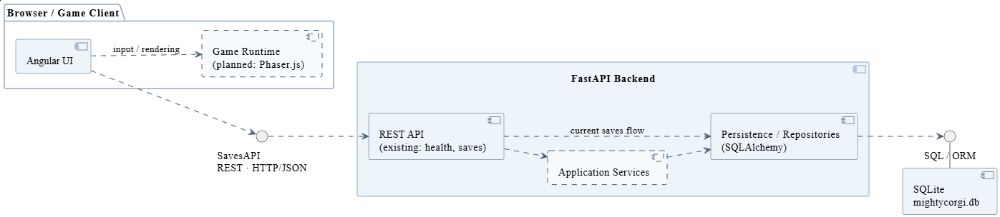

# [Project Name] — Software Architecture Document

<!--
HOW TO USE THIS TEMPLATE
- Copy this file into the docs/ folder of your repository, next to SRS.md.
- Replace every [placeholder] in square brackets. Comments like this one are guidance: they
  are invisible on GitHub, and you may delete them once a section is done.
- Keep every heading and its number. Sections marked "Lecture 7" or later stay as they are
  until that lecture. If a section does not apply, write "Not applicable" and one sentence why.
- Every section you write names its author: in the "Author" line below its heading, or in
  the Author column of a table.
- Put every diagram into docs/diagrams/, the image together with its source file.
- Structure after the RUP template "Software Architecture Document":
  https://cin.ufpe.br/~if682/RUP/webtmpl/templates/a_and_d/rup_sad.htm
-->

| Team | Version | Last change |
| ---- | ------- | ----------- |
| MIGHTYCorgi | [0.1] | 30.10.2026 |

The Git history of this file is the revision history.

## Table of contents

1. [Introduction](#1-introduction)
2. [Architectural representation](#2-architectural-representation)
3. [Architectural goals and constraints](#3-architectural-goals-and-constraints)
4. [Use-case view](#4-use-case-view)
5. [Logical view](#5-logical-view)
6. [Process view](#6-process-view)
7. [Deployment view](#7-deployment-view)
8. [Implementation view](#8-implementation-view)
9. [Data view](#9-data-view)
10. [Size and performance](#10-size-and-performance)
11. [Quality](#11-quality)

## 1 Introduction

### 1.1 Purpose

*Author: Kilian*

This document describes the software architecture of MIGHTYCorgi, a roguelike game in which the player controls a corgi, fights enemies, collects items, and progresses through different rooms. It provides an overview of the system's main components, their responsibilities, interactions, and deployment. The document serves as a technical reference for the development team and the lecturer acting as the project's investor. Its purpose is to ensure a shared understanding of the architecture and support future development and maintenance.

### 1.2 Scope

*Author: Kilian*

This document covers the software architecture of MIGHTYCorgi, a browser-based, single-player action dungeon crawler roguelike. It includes the frontend built with Angular, TypeScript, and Phaser.js, the backend developed with Python and FastAPI, and the SQLite database used for persistent storage.

The architecture supports core features such as character creation and management, real-time combat, randomized dungeon rooms, item collection, inventory management, and character progression. Native desktop and mobile applications, as well as multiplayer functionality, are excluded from the current project scope.

The detailed functional scope, including in-scope and out-of-scope features, is described in [SRS 1.2](SRS.md#12-scope).

### 1.3 Definitions, acronyms and abbreviations

*Author: Kilian*

| Term | Meaning |
|---|---|
| SAD | Software Architecture Document – Describes the structure, components, and deployment of the system. |
| SRS | Software Requirements Specification – Defines the functional and non-functional requirements of the application. |
| UML | Unified Modeling Language – Standardized language for visualizing software architecture and design. |
| UCR | Use-Case Realization – Describes how system components and classes implement a specific use case. |
| API | Application Programming Interface – Enables communication between software components. |
| Frontend | The client-side application responsible for the user interface and game rendering. |
| Backend | The server-side application responsible for processing requests and managing persistent data. |
| Angular | TypeScript-based framework used to develop the frontend. |
| Phaser.js | JavaScript game framework used to implement and render the 2D gameplay. |
| FastAPI | Python framework used to implement the backend API. |
| SQLite | Relational database used for persistent storage of game data. |
| ORM | Object-Relational Mapping – Technique for accessing database records through programming language objects. |
| SQLAlchemy | Python library used for database access and object-relational mapping. |
| Alembic | Database migration tool used to manage changes to the database schema. |
| Component | A modular part of the software system with defined responsibilities and interfaces. |
| Deployment | The distribution of software components across execution environments and devices. |
| PlantUML | Text-based tool for creating UML diagrams from source code. |

### 1.4 References

*Author: Kilian*

| Title | Link |
| ----- | ---- |
| SRS | [SRS.md](SRS.md) |
| Domain model | [domain_model.png](diagrams/domain_model.png) |
| Repository | https://github.com/xniklasx-dev/MIGHTYCorgi |
| Board | https://github.com/users/xniklasx-dev/projects/1 |

### 1.5 Overview

Section 2 names the views this document uses. Sections 3 to 11 describe the architecture view
by view, following the RUP template.

## 2 Architectural representation

*Author: Kilian*

The software architecture of MIGHTYCorgi is documented using the 4+1 architectural view model. Each view describes a different aspect of the system to provide a clear understanding of its structure, behavior, and deployment.

The architecture consists of an Angular and Phaser.js frontend for the user interface and real-time gameplay, a Python FastAPI backend for server-side functionality, and an SQLite database for persistent storage.

| View | Question it answers | Diagram | Section |
|---|---|---|---|
| Use-case view | What functionality does the system provide, and who interacts with it? | Use-case diagram and use-case realizations | 4 |
| Logical view | Which classes and domain objects exist, and how are they related? | Domain model and class diagrams | 5 |
| Process view | How do the system components interact during runtime? | Sequence and activity diagrams | 6 |
| Deployment view | Where are the application components deployed, and how do they communicate? | UML deployment diagram | 7 |
| Implementation view | How is the application divided into components, and what are their responsibilities? | UML component diagram and package diagram | 8 |

## 3 Architectural goals and constraints

<!-- Lecture 7. The requirements and constraints that shape your architecture: quality goals
     such as availability or security, and constraints such as your stack (SRS 3.6), your team
     size, or your schedule. Leave this section as it is until then. -->

*Follows with Lecture 7.*

## 4 Use-case view

*Author: Kilian*

The use-case view describes the main interactions between the player and MIGHTYCorgi. The complete use-case diagram, containing twelve use cases, is available in [SRS 2.2](SRS.md#22-use-case-diagram).

The use cases most significant for the architecture are UC-02 Move the Corgi, UC-03 Select a Corgi Class, UC-04 Customize a Corgi, and UC-05 Collect Item Drops. These cover important aspects of the game, including player movement, character creation, customization, and item collection.

Their use-case realizations describe how the participating objects and components collaborate to implement the specified functionality.

### 4.1 Use-case realizations

The following table links the existing use-case specifications to their corresponding realizations.

| Use case | Realization | Author |
|---|---|---|
| [UC-02 Move the Corgi](use_cases/UC-02_Corgi_Movement.md) | [UCR-02](use_case_realizations/UCR-02_Corgi_Movement.md) | Andreas |
| [UC-03 Select a Corgi Class](use_cases/UC-03_Corgi_Class_Selection.md) | [UCR-03](use_case_realizations/UCR-03_select_a_corgi_class.md) | Niklas |
| [UC-04 Customize a Corgi](use_cases/UC-04_Corgi_Customization.md) | [UCR-04](use_case_realizations/UCR-04_Corgi_Customization.md) | Tony |
| [UC-05 Collect Item Drops](use_cases/UC-05_Item_Collection.md) | [UCR-05](use_case_realizations/UCR-05_drop_and_collect_items.md) | Kilian |

## 5 Logical view

### 5.1 Overview

*Author: Kilian*

The logical view describes the main domain classes of MIGHTYCorgi and their relationships. It provides an overview of the game's data structures and serves as a foundation for the detailed design of the application.

The domain model includes the Player, Corgi, Run, Room, Enemy, CharacterClass, Inventory, and Item classes, as well as supporting classes and enumerations.

A Player can own multiple Corgis, each with a selected character class and its own inventory. A Corgi can participate in multiple runs, which consist of several rooms containing enemies and different themes. Items are stored in the Corgi's inventory and are categorized by rarity.

The complete domain model is available in [Domain Model](diagrams/domain_model.puml). Its visual representation can be viewed [here](diagrams/domain_model.png).

### 5.2 Architecturally significant design packages

*Author: Kilian*

The architecture of MIGHTYCorgi is divided into several logical areas based on the responsibilities identified in the use-case realizations. These areas separate user interaction, gameplay logic, character management, and persistent data.

| Design area | Responsibility | Main design classes | Reference |
|---|---|---|---|
| Movement System | Processes player input, character movement, and collision handling. | `InputManager`, `GameRenderer`, `PlayerController`, `LevelManager`, `CorgiModel` | [UCR-02](use_case_realizations/UCR-02_Corgi_Movement.md#25-design-classes) |
| Character Creation | Handles character creation, class selection, and character initialization. | `CorgiCreationComponent`, `CorgiApiService`, `CorgiController`, `CorgiCreationService`, `CorgiClass`, `ClassRepository`, `CorgiRepository` | [UCR-03](use_case_realizations/UCR-03_select_a_corgi_class.md#25-design-classes) |
| Corgi Customization | Manages visual customization, previews, validation, and saving character appearances. | `CustomizationPopupView`, `CustomizationSession`, `CorgiVisualService`, `VisualDraft`, `CorgiVisualProfile`, `VisualProfileRepository` | [UCR-04](use_case_realizations/UCR-04_Corgi_Customization.md#25-design-classes-task-05) |
| Item System | Manages item drops, pickups, inventory updates, temporary effects, and item-to-XP conversion. | `GameView`, `InventoryView`, `ItemDropService`, `ItemConversionService`, `DropRules`, `WorldPickup`, `Inventory`, `CharacterState` | [UCR-05](use_case_realizations/UCR-05_drop_and_collect_items.md#25-design-classes) |

## 6 Process view

*Author: Kilian*

MIGHTYCorgi consists of three main runtime components: the frontend, backend, and database.

The frontend runs in the player's web browser using Angular and Phaser.js. It handles user input, game rendering, character movement, real-time combat, and visual feedback through the game loop.

The backend runs as a Python FastAPI application and processes requests related to character management, progression, inventory, and persistent game data. Communication between the frontend and backend takes place through HTTP requests.

The SQLite database stores persistent information such as character attributes, experience points, inventory contents, and equipment. The backend accesses the database using SQLAlchemy.

Real-time gameplay is primarily handled by the frontend, while operations requiring persistent storage are processed by the backend. This separation allows gameplay to continue independently of individual database operations.

## 7 Deployment view

*Author: Andreas*

The deployment view describes how MIGHTYCorgi is deployed and executed in its current local development environment. The application runs on a developer's laptop and consists of a browser-based frontend, a FastAPI backend, and an SQLite database.

The frontend is developed using Angular and TypeScript and is served by the Angular development server running on Node.js 24+. Players access the application through a web browser at `http://localhost:4200`.

The backend runs in a Python 3.14 virtual environment and uses FastAPI to provide REST API endpoints. It is accessible locally at `http://localhost:8000`. Communication between the frontend and backend uses HTTP requests through the Angular development proxy.

Persistent data is stored in a local SQLite database (`mightycorgi.db`). The backend accesses the database through SQLAlchemy using local file operations. Database schema changes are managed with Alembic migrations.

The following UML deployment diagram illustrates the current development setup, including execution environments, deployed artifacts, and communication paths.

The PlantUML source file is available [here](diagrams/deployment.puml).

| Node | What runs there | Connected to |
|---|---|---|
| Developer Laptop | Hosts the frontend, backend, and SQLite database | Local execution environments |
| Web Browser | Executes the Angular single-page application | Angular Development Server via HTTP (port 4200) |
| Node.js 24+ | Runs the Angular Development Server | Web Browser via HTTP (4200), FastAPI Backend via HTTP proxy (8000) |
| Python 3.14 (.venv) | Runs the FastAPI backend and application logic | Angular Development Server via HTTP (8000), SQLite via File I/O |
| SQLite Engine | Provides local persistent data storage | FastAPI Backend via local File I/O |

This deployment configuration allows developers to run and test the complete application locally without requiring external hosting services.

The diagram represents the current development environment. A separate production deployment configuration has not yet been defined and may be added in a later development phase.

## 8 Implementation view

### 8.1 Overview

*Author: Tony*

The implementation view describes the main software components of MIGHTYCorgi, their responsibilities, and their dependencies.

The application follows a client-server architecture consisting of an Angular frontend, a Python FastAPI backend, and an SQLite database.

The frontend is responsible for user interaction and will use Phaser.js for rendering and executing real-time gameplay. The backend provides a REST API for communication with the frontend and manages persistent game data using SQLAlchemy.

The current implementation includes a basic Angular interface, FastAPI endpoints for health checks and game saves, and SQLite persistence. Additional gameplay components and application services are planned for future development.

The following component diagram illustrates the current and planned system structure.

The PlantUML source file is available [here](diagrams/components.puml).

| Component | Responsibility | Classes / Modules |
|---|---|---|
| Angular UI | Provides the graphical user interface and communicates with the backend. | `App`, `HttpClient` |
| Game Runtime (planned) | Handles real-time gameplay, rendering, movement, combat, and game interactions using Phaser.js. | Planned gameplay classes from the use-case realizations |
| REST API | Processes HTTP requests and provides endpoints for health checks and game saves. | `main.py`, `health.py`, `saves.py` |
| Application Services (planned) | Coordinates gameplay-related business logic, character management, and item processing. | Planned service classes from Task 5 |
| Persistence / Repositories | Handles database operations and persistent storage through SQLAlchemy. | `database.py`, `models.py`, `GameSave` |
| SQLite Database | Stores persistent game information, including the currently implemented game saves. | `mightycorgi.db`, `game_saves` |

The components communicate through defined interfaces. The Angular frontend uses HTTP requests to access the FastAPI REST API. Within the backend, database operations are performed using SQLAlchemy.

This modular structure is intended to separate responsibilities and support independent development, testing, and maintenance of individual components.

### 8.2 Layers

*Follows with Lectures 8 and 9.*

## 9 Data view

<!-- Optional for now. Later: your database schema or ER model, derived from your domain model. -->

*Follows later.*

## 10 Size and performance

<!-- Lecture 7. The numbers that shape your architecture, e.g., expected users and data, and
     your performance requirements from SRS 3.4. Leave this section as it is until then. -->

*Follows with Lecture 7.*

## 11 Quality

<!-- Lectures 7 to 9. How your architecture supports the qualities you need: availability,
     security, maintainability, … Leave this section as it is until then. -->

*Follows with Lectures 7 to 9.*
