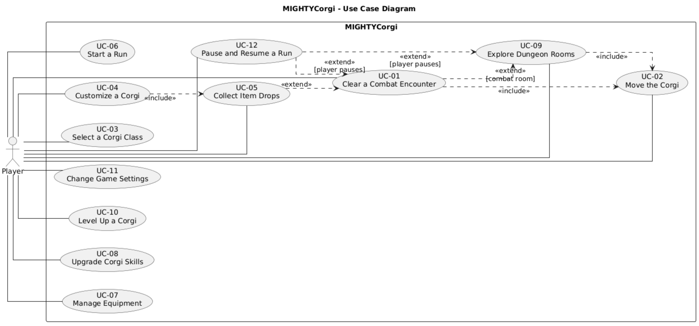
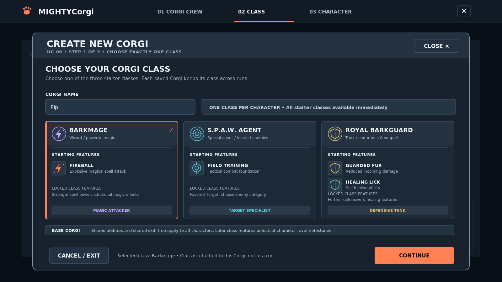
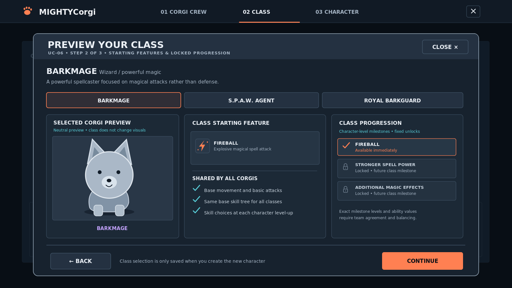
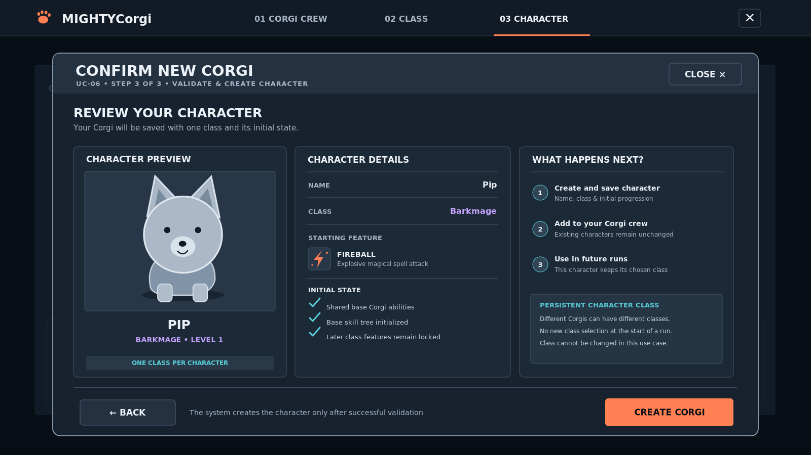
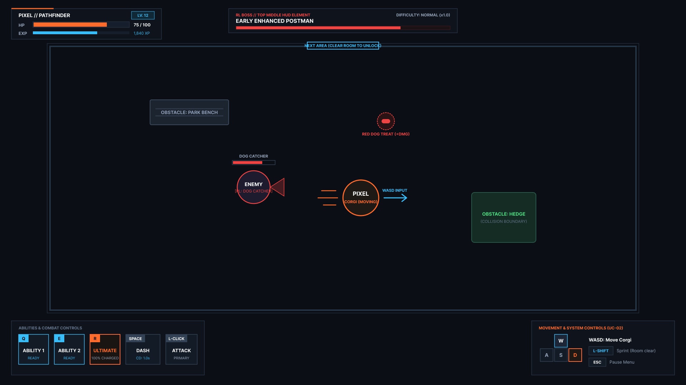
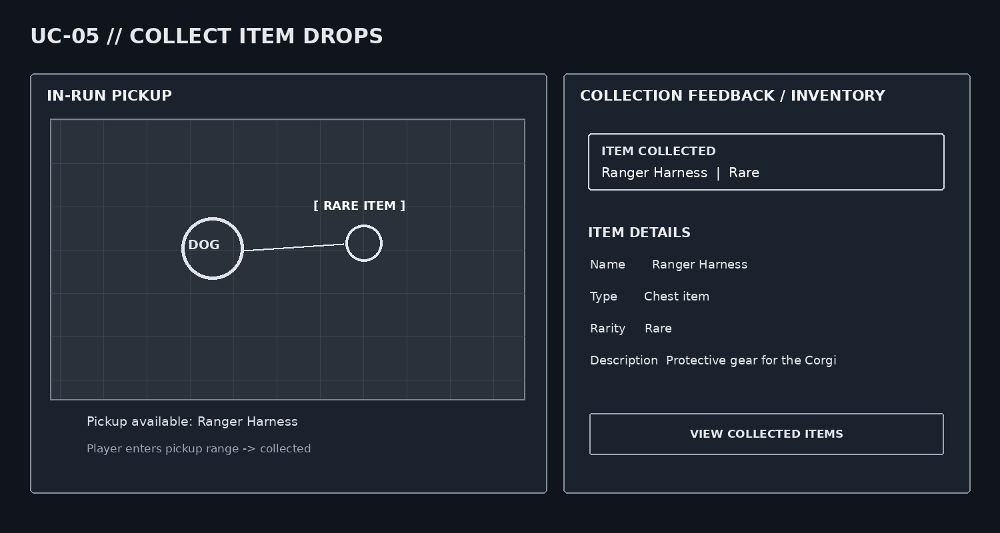

# MIGHTYCorgi — Software Requirements Specification

<!--
HOW TO USE THIS TEMPLATE
- Copy the whole docs/ folder into your repository.
- Replace every [placeholder] in square brackets. Comments like this one are guidance: they
  are invisible on GitHub, and you may delete them once a section is done.
- Keep every heading and its number. If a section does not apply, write
  "Not applicable" and one sentence why.
- Every section you write names its author: in the "Author" line below its heading, or in
  the Author column of a table. Prefilled sections need no author.
- Structure after the RUP template "Software Requirements Specification":
  https://cin.ufpe.br/~if682/RUP/webtmpl/templates/req/rup_srs.htm
-->

| Team        | Version | Last change |
| ----------- | ------- | ----------- |
| MIGHTYCorgi | 0.1     | 18.10.2026  |

The Git history of this file is the revision history.

## Table of contents

1. [Introduction](#1-introduction)
2. [Overall description](#2-overall-description)
3. [Specific requirements](#3-specific-requirements)
4. [Supporting information](#4-supporting-information)

## 1 Introduction

### 1.1 Purpose

_Author: Niklas_

<!-- One paragraph: what this document describes and who reads it
     (your team, the lecturer as investor, the developer who takes over). -->

This Software Requirements Specification (SRS) describes the intended functionality, quality requirements, interfaces, and constraints of MIGHTYCorgi. It provides a common basis for the project team to plan, implement, and test the game, for the lecturer in the role of investor to evaluate the proposed product, and for future developers to understand and maintain it. The document will be updated as the requirements are refined during development.

### 1.2 Scope

_Author: Niklas_

<!-- What the software does and for whom, in two or three sentences.
     Then split explicitly into in scope and out of scope, each with a reason.
     Out of scope = your MoSCoW "won't have this time". Document later changes here. -->

MIGHTYCorgi is a browser-based, room-based action dungeon crawler roguelike in which players control their Corgis through randomly ordered rooms, complete missions, fight increasingly difficult enemies, and try to survive as long as possible. Players can own multiple Corgi characters, choose one of currently three starting specializations for each character, and progress through separate player-level and character-level systems. Runs offer temporary upgrades, enemy and room events, and collectible rewards, while experience, inventory, equipment, character skills, and class-specific features support progression between runs.

### In scope

| Priority    | Feature                                                                                                | Reason                                                                                                               |
| ----------- | ------------------------------------------------------------------------------------------------------ | -------------------------------------------------------------------------------------------------------------------- |
| Must Have   | Browser-based game with a graphical user interface                                                     | Makes the game accessible without installation and provides the foundation for all gameplay and management features. |
| Must Have   | Multiple Corgi characters with three starting classes selected during character creation               | Enables players to create different characters with distinct abilities and playstyles.                               |
| Must Have   | Character experience, level-ups, a shared base skill tree, and predefined class milestone features     | Establishes the core progression system by combining customizable base abilities with class-specific features.       |
| Must Have   | Room-based runs with randomized room order and boss encounters                                         | Forms the core dungeon-crawler roguelike gameplay loop and provides variety between runs.                            |
| Must Have   | Missions and room objectives, including defeating enemies and surviving encounters                     | Gives players clear objectives and a sense of progression throughout each run.                                       |
| Must Have   | Real-time melee and ranged combat with health, attacks, movement abilities, and cooldowns              | Provides the fundamental gameplay mechanics and allows different combat strategies.                                  |
| Must Have   | Basic enemies, combat rewards, and item drops                                                          | Creates challenges and rewards that motivate players to continue playing.                                            |
| Must Have   | Persistent character data, progression, and collected items                                            | Ensures that progress and rewards are retained between runs and game sessions.                                       |
| Must Have   | Character selection, class selection, character management, gameplay HUD, pause menu, and death screen | Provides the essential interfaces needed to navigate and play the game.                                              |
| Should Have | Separate player progression with unlockable classes, equipment slots, and customization options        | Provides additional long-term motivation beyond individual character progression.                                    |
| Should Have | Difficulty selection and increasing challenge throughout runs and completed missions                   | Accommodates different player skill levels and keeps longer runs challenging.                                        |
| Should Have | Three randomly selected temporary upgrades offered after completing a room                             | Adds strategic decisions and enables different character builds within individual runs.                              |
| Should Have | Different enemy types, themed rooms, and additional boss encounters                                    | Increases gameplay variety and encourages players to adapt their strategies.                                         |
| Should Have | Persistent inventory with functional equipment slots and equippable items                              | Allows players to customize their characters' equipment and make meaningful use of collected loot.                   |
| Should Have | Item rarities and the option to convert unwanted items into experience points                          | Adds value to item collection and provides alternative ways to use unwanted rewards.                                 |
| Could Have  | Bonus rooms, including puzzles, treasure rooms, shops, and optional boss encounters                    | Introduces additional activities and rewards outside regular combat encounters.                                      |
| Could Have  | Random room events and special enemy drops                                                             | Creates unexpected situations and increases replayability.                                                           |
| Could Have  | Visual equipment and detailed Corgi customization                                                      | Allows players to personalize their characters' appearance without affecting the core gameplay.                      |

### Out of scope

| Priority   | Feature                                | Reason                                                                                                                                                                                 |
| ---------- | -------------------------------------- | -------------------------------------------------------------------------------------------------------------------------------------------------------------------------------------- |
| Won't Have | Native desktop and mobile applications | Focusing on a browser-based application reduces platform-specific development and maintenance effort.                                                                                  |
| Won't Have | Multiplayer or cooperative game modes  | Multiplayer would require additional networking, synchronization, and balancing systems, significantly increasing development complexity beyond the intended single-player experience. |

### 1.3 Definitions, acronyms and abbreviations

_Author: Niklas_

| Term                      | Meaning                                                                                                              |
| ------------------------- | -------------------------------------------------------------------------------------------------------------------- |
| SRS                       | Software Requirements Specification                                                                                  |
| UC                        | Use case                                                                                                             |
| NFR                       | Non-functional requirement (quality requirement or constraint)                                                       |
| RUP                       | Rational Unified Process; the process model underlying the document structure.                                       |
| UML                       | Unified Modeling Language; notation used for system diagrams.                                                        |
| GUI                       | Graphical user interface.                                                                                            |
| HUD                       | Heads-up display; information presented on the gameplay screen.                                                      |
| API                       | Application programming interface.                                                                                   |
| Run                       | A single gameplay attempt consisting of rooms and encounters, during which difficulty can increase.                  |
| Mission                   | A goal to be completed during gameplay, in addition to surviving and clearing rooms.                                 |
| Room theme                | A thematic setting that groups multiple rooms and may influence encounters and events.                               |
| Corgi character           | An individual character owned by a player, with its own chosen class, character level, and progression.              |
| Player level              | Progression independent of an individual character; it can unlock classes, item slots, or customization options.     |
| Character level           | Progression earned by an individual Corgi after reaching an experience threshold.                                    |
| Base Corgi                | The shared foundation of abilities and progression available to every Corgi character.                               |
| Class                     | A specialization chosen during character creation that adds class-specific abilities to the shared Corgi foundation. |
| Base skill tree           | Shared character improvements from which the player can choose when a Corgi levels up.                               |
| Class feature             | A predetermined specialization-specific feature unlocked at a designated character-level milestone.                  |
| Temporary upgrade         | A run-specific boost or feature selected from three random options after a room.                                     |
| Inventory                 | Collection of items retained for use or management outside a run.                                                    |
| Functional equipment slot | A slot in which an item provides gameplay functionality, such as a collar or weapon slot.                            |
| Visual equipment slot     | A slot for displaying an item on the Corgi's appearance.                                                             |
| Rarity                    | The classification of an item as common, uncommon, rare, epic, legendary, or mythic.                                 |
| Treat                     | A possible enemy drop that provides an effect, such as a temporary combat or movement bonus.                         |
| XP                        | Experience points used in the game's progression systems.                                                            |

### 1.4 References

_Author: Niklas_

| Title             | Link                                                    |
| ----------------- | ------------------------------------------------------- |
| Blog              | https://github.com/xniklasx-dev/MIGHTYCorgi/discussions |
| Board             | https://github.com/users/xniklasx-dev/projects/1        |
| GitHub repository | https://github.com/xniklasx-dev/MIGHTYCorgi             |

### 1.5 Overview

Section 2 describes the product as a whole: vision and use case diagram. Section 3 lists the
specific requirements: the use cases (3.1) and the quality requirements and constraints
(3.2 to 3.12).

## 2 Overall description

### 2.1 Vision

_Author: Niklas_

<!-- Your vision from Task 1, updated: the problem, the target group and the stakeholders,
     the value, and how you differ from alternatives. The investor should get it in two minutes. -->

MIGHTYCorgi aims to offer a replayable, Corgi-themed action dungeon crawler roguelike in which players explore rooms, complete missions, fight themed enemies and bosses, and survive escalating challenges. Runs combine real-time combat with randomly ordered themed rooms, events, loot, and a choice of three temporary boosts after each completed room. Progress persists beyond individual runs: a separate player level can unlock more options, while each owned Corgi collects experience and items, levels up, develops its shared base skill tree, and gains predetermined features from the class chosen at character creation. Equipment, item rarities, and visual customization give players further ways to develop distinct Corgis. The game combines everyday dog-related themes and fantasy encounters, targeting players who enjoy replayable combat, experimentation, character development, and gradual progression. Its primary stakeholders are the players, the development team, the lecturer acting as investor, and future developers and maintainers.

### 2.2 Use case diagram

_Author: Kilian_

<!-- One UML use case diagram for the whole application, at least five high-level use cases;
     login and registration do not count. Commit the source file next to the image. -->

### 2.3 Assumptions and dependencies

_Author: Niklas_

<!-- Optional: what you assume (e.g., users have a DHBW account) and what you depend on
     (e.g., an external API). Delete the comment and write "None" if there are none. -->

Players are assumed to access the game in a modern browser with keyboard and mouse input. The game depends on its Angular/TypeScript frontend, Phaser.js for implementing and rendering the 2D gameplay, FastAPI/Python backend, and SQLite persistence, accessed through SQLAlchemy with Alembic migrations.

## 3 Specific requirements

### 3.1 Functionality

<!-- One subsection per use case. The specification lives in its own file in use_cases/,
     created from UC-00_template.md. Here: name, author, one sentence, link.
     Task 3: at least one specified use case per team member (four entries with a link below).
     List every use case of your diagram; mark the ones not specified yet as "planned". -->

#### 3.1.1 UC-01 Clear a Combat Encounter

_Author: MIGHTYCorgi_ · The player engages in real-time combat using attacks, movement, and class abilities to defeat enemies and complete encounters. · [Specification](use_cases/UC-01_Combat_System.md)

#### 3.1.2 UC-02 Move the Corgi

_Author: Andreas_ · The player controls the Corgi's movement using WASD keys to navigate and explore the game world. · [Specification](use_cases/UC-02_Corgi_Movement.md)

#### 3.1.3 UC-03 Select a Corgi Class

_Author: Niklas_ · The player selects one of three available classes during character creation, defining the Corgi's playstyle and class-specific abilities. · [Specification](use_cases/UC-03_Corgi_Class_Selection.md)

#### 3.1.4 UC-04 Customize a Corgi

_Author: Tony_ · The player customizes a Corgi's appearance and equipment by modifying visual features and equipping functional items that affect its stats and abilities. · [Specification](use_cases/UC-04_Customize_a_Corgi.md)

#### 3.1.5 UC-05 Collect Item Drops

_Author: Kilian_ · The player collects items and temporary treats from defeated enemies or room events to obtain rewards, enhance gameplay, and manage collected resources. · [Specification](use_cases/UC-05_Item_Collection.md)

#### 3.1.6 UC-06 Start a Run

_Author: MIGHTYCorgi_ · The player starts a new dungeon run with a selected Corgi character and difficulty level. · planned

#### 3.1.7 UC-07 Manage Equipment

_Author: MIGHTYCorgi_ · The player manages a Corgi character's inventory and equips or unequips collected items to customize its equipment and attributes. · planned

#### 3.1.8 UC-08 Upgrade Corgi Skills

_Author: MIGHTYCorgi_ · The player selects and unlocks improvements from the shared Corgi skill tree to enhance a character's abilities. · planned

#### 3.1.9 UC-09 Explore Dungeon Rooms

_Author: MIGHTYCorgi_ · The player explores randomly arranged dungeon rooms, encounters enemies and events, and completes room objectives to progress through a run. · planned

#### 3.1.10 UC-10 Level Up a Corgi

_Author: MIGHTYCorgi_ · The player levels up a Corgi character by accumulating experience points, unlocking new skill tree options and predefined class-specific features at designated levels. · planned

#### 3.1.11 UC-11 Change Game Settings

_Author: MIGHTYCorgi_ · The player adjusts game settings, such as audio and display preferences, to customize the gaming experience. · planned

#### 3.1.12 UC-12 Pause and Resume a Run

_Author: MIGHTYCorgi_ · The player pauses an ongoing dungeon run to temporarily stop gameplay and resumes it from the same state. · planned

<!-- QUALITY REQUIREMENTS (3.2 to 3.5)
     At least one per section. Each one: an ID, one sentence with "shall", a number you can
     test, and if possible stimulus, response and measure. IDs are unique in the whole SRS,
     including the special requirements of your use cases.
     Example: NFR-P-01 — When 50 users search at the same time, the app lists free slots
     within 1 s for 95 % of the requests. -->

## 3.2 Usability

| ID       | Requirement                                                                                                                                                                                                        | Author |
| -------- | ------------------------------------------------------------------------------------------------------------------------------------------------------------------------------------------------------------------ | ------ |
| NFR-U-01 | At least 8 out of 10 first-time players shall be able to navigate the main menu, select a character, and start their first run within 3 minutes without external assistance.                                       | Tony   |
| NFR-U-02 | At least 8 out of 10 first-time players shall be able to correctly identify the purpose of the main menu options and understand their basic functions without external assistance.                                 | Tony   |
| NFR-U-03 | At least 8 out of 10 first-time players shall be able to locate and access the game's main features, such as character management, customization, and game settings, within 2 minutes without external assistance. | Tony   |

### 3.3 Reliability

| ID       | Requirement                                                                                                                                                       | Author |
| -------- | ----------------------------------------------------------------------------------------------------------------------------------------------------------------- | ------ |
| NFR-R-01 | Save consistency: In 100 consecutive save and reload tests, the player's character level, inventory, and equipped items shall remain unchanged.                   | Kilian |
| NFR-R-02 | Item consistency: In 100 consecutive item pickup tests, each collected item shall be added to the inventory exactly once.                                         | Kilian |
| NFR-R-03 | Combat consistency: In 100 consecutive combat tests, enemies and players reaching 0 HP shall be marked as defeated and prevented from performing further attacks. | Kilian |
| NFR-R-04 | Error recovery: If saving fails, the game shall inform the player and shall not report the save operation as successful.                                          | Kilian |

### 3.4 Performance

| ID       | Requirement                                                                                                                                                                                                          | Author  |
| -------- | -------------------------------------------------------------------------------------------------------------------------------------------------------------------------------------------------------------------- | ------- |
| NFR-P-01 | **Input latency:** When the player presses a movement (WASD) or ability key (Q, E, R, Space), the corresponding Corgi animation and action shall be rendered on screen within 16 milliseconds in 95% of test inputs. | Andreas |
| NFR-P-02 | **Frame rate stability:** During active combat with up to 15 simultaneous enemies and active treat effects in a room, the game client shall maintain a minimum frame rate of 60 FPS for 99% of the combat duration.  | Andreas |
| NFR-P-03 | **Room generation time:** When starting a new run or transitioning to the next room, the procedural generation and rendering of the new room layout shall complete within 1.5 seconds in 95% of transitions.         | Andreas |
| NFR-P-04 | **UI and progression loading:** Switching between out-of-run menus (Corgi Crew, Class Selection, Loadout) or loading the end-of-room temporary boost selection shall complete within 500 milliseconds.               | Andreas |

### 3.5 Supportability

| ID       | Requirement                                                                                                                                                                                                               | Author |
| -------- | ------------------------------------------------------------------------------------------------------------------------------------------------------------------------------------------------------------------------- | ------ |
| NFR-S-01 | Setup and maintainability: A new developer shall be able to set up and run the frontend, backend, and database within 20 minutes by following the project's installation instructions on a supported development machine. | Niklas |
| NFR-S-02 | Testability: At least 80% of the application's business and gameplay logic shall be covered by automated tests, as measured by code coverage reports.                                                                     | Niklas |
| NFR-S-03 | Configurability: The game shall allow difficulty multipliers to be modified without changing the combat logic, verified by successfully testing the updated values for all supported difficulty settings.                 | Niklas |

### 3.6 Design constraints

_Author: Niklas_

<!-- Decisions that are fixed, not chosen per feature: your stack. -->

| ID    | Constraint                                                                      |
| ----- | ------------------------------------------------------------------------------- |
| DC-01 | Frontend: TypeScript with Angular, Phaser.js as game engine.                    |
| DC-02 | Backend: Python with FastAPI.                                                   |
| DC-03 | Database: SQLite, accessed through SQLAlchemy, database migrations use Alembic. |

### 3.7 Online user documentation and help system requirements

_Author: Niklas_

Not applicable. No separate online user manual or dedicated help system is planned for the current game scope.

### 3.8 Purchased components

_Author: Niklas_

Not applicable. No purchased third-party software components are needed in the current technology stack.

### 3.9 Interfaces

_Author: Niklas_

#### 3.9.1 User interfaces

<!-- Link the mockups of your use cases, or describe the main screens in one line each. -->

##### Main Menu

Displays all available Corgi characters in a grid layout and provides access to the game settings and quit option.

##### Class Selection

##### Class Preview

##### Character Confirmation

##### Corgi Customization

##### Corgi Customization: Cosmetic Equipment

##### Corgi Customization: Functional Equipment

##### Combat

##### Item Collection

#### 3.9.2 Hardware interfaces

Not applicable. No dedicated hardware interface or special peripheral is required, the game is accessed through a standard browser and input devices.

#### 3.9.3 Software interfaces

<!-- External services and APIs you use, e.g., an e-mail service. -->

No integration with an external third-party service or API is currently specified.

#### 3.9.4 Communications interfaces

<!-- E.g., HTTPS between frontend and backend. -->

The frontend and backend exchange HTTP requests and responses during local development. The development endpoints are `http://localhost:4200` for the frontend and `http://localhost:8000` for the backend, the frontend development setup uses an API proxy. Production deployment and HTTPS configuration have not yet been specified.

### 3.10 Licensing requirements

_Author: Niklas_

<!-- The license of your project, and of libraries that impose conditions. -->

A project-wide license has not yet been documented. The project uses third-party frameworks and libraries, including Angular, FastAPI, SQLAlchemy, and Alembic, whose applicable license terms and notices must be respected when software is distributed. The team must determine the license for its own source code and any externally distributed game assets before publication.

### 3.11 Legal, copyright and other notices

_Author: Niklas_

<!-- E.g., data protection (GDPR) if you store personal data. -->

The game will respect copyrights and license conditions for any third-party graphics, music, sound effects, fonts, or other assets that will be used. If player accounts or other information that identifies individuals are stored or processed, applicable data protection obligations, including the GDPR where relevant, will be evaluated and addressed. The specifics of a detailed personal-data model or a privacy policy ar not yet defined.

### 3.12 Applicable standards

_Author: Niklas_

<!-- E.g., WCAG 2.2 level AA, a coding standard. -->

Requirements documentation follows the supplied RUP-based SRS and use-case specification templates, and project documentation is maintained in Markdown under version control. No additional mandatory coding standard, accessibility conformance level, or certification is currently defined.

## 4 Supporting information

_Author: Niklas_

<!-- Optional: appendices, glossary extensions, interview notes. -->

None.
