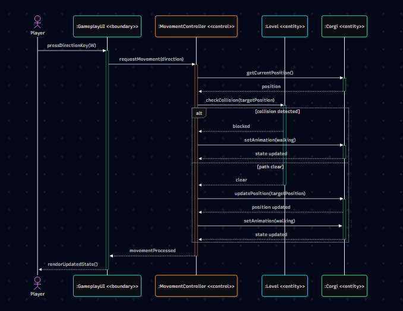

# Use-Case Realization: UC-02 Move the Corgi

| Author | Andreas |
| :--- | :--- |

## 1 Introduction
This realization describes how the system executes UC-02. It shows how player keyboard inputs are processed to calculate movement, verify path clearance against obstacles, and update the Corgi's coordinates and animations on the screen.

## 2.1 Participating objects

| Object | Stereotype | Responsibility |
| :--- | :--- | :--- |
| `:GameplayUI` | `<<boundary>>` | Captures WASD inputs from the player and renders the updated game state. |
| `:MovementController` | `<<control>>` | Processes movement requests, checks collisions, and determines new coordinates. |
| `:Level` | `<<entity>>` | Provides data about room boundaries and obstacle placements. |
| `:Corgi` | `<<entity>>` | Holds the character's current coordinates, speed, and animation state. |

## 2.2 Sequence diagrams

## 2.3 Walkthrough

The player initiates movement through the `:GameplayUI`. The boundary passes this request to the `:MovementController`, which calculates the intended target coordinates based on the `:Corgi`'s current position. The controller then queries the `:Level` entity to determine if the target position is blocked by a boundary or obstacle. If the path is clear, the controller updates both the position and the animation state of the `:Corgi`. If a collision is detected, only the animation state is updated to simulate walking against an obstacle. Finally, the UI renders the new state for the player.
