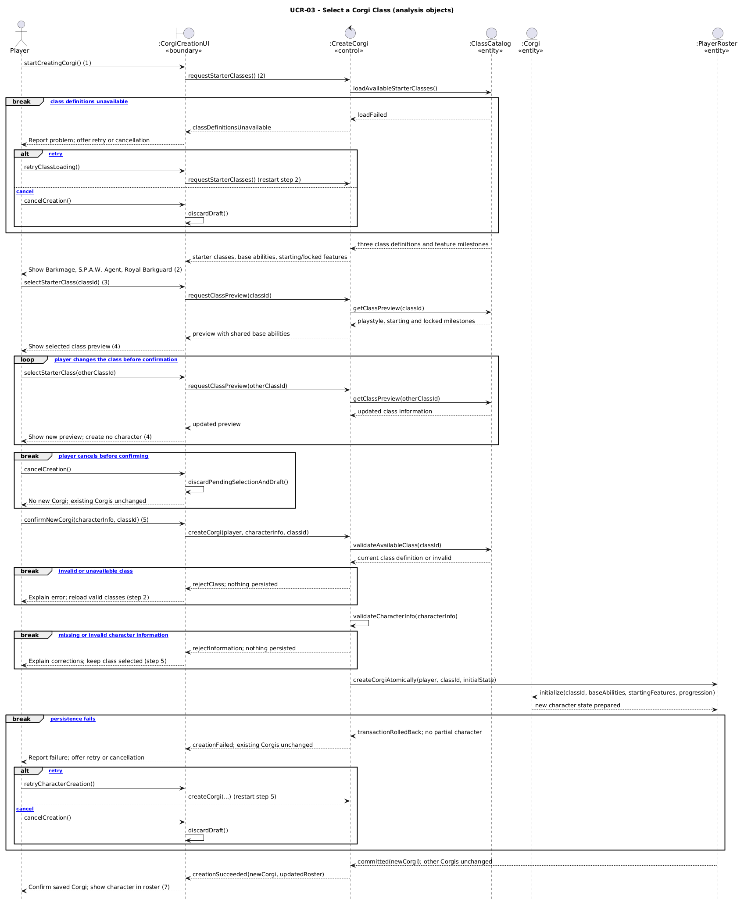

# UCR-03 Select a Corgi Class — Use-Case Realization

| Author | Realizes                                                                  |
| ------ | ------------------------------------------------------------------------- |
| Niklas | [UC-03 Select a Corgi Class](../use_cases/UC-03_Corgi_Class_Selection.md) |

## 1 Introduction

This realization describes how the analysis objects of MIGHTYCorgi collaborate to implement [UC-03 Select a Corgi Class](../use_cases/UC-03_Corgi_Class_Selection.md) during the creation of a new Corgi character. It covers basic-flow steps 1–7 and alternative flows 2a, 3a, 5a, 6a, 6b and 6c, including validation, persistence and recovery after errors. Character leveling, unlocking later class features, inventory management and changing the class of an existing Corgi are outside the scope of UC-03.

## 2 Flow of events — design

### 2.1 Participating objects

| Object             | Stereotype   | Responsibility                                                                                                                         |
| ------------------ | ------------ | -------------------------------------------------------------------------------------------------------------------------------------- |
| `:CorgiCreationUI` | `«boundary»` | Accepts the player's class selection and character information, presents class previews, and communicates creation results and errors. |
| `:CreateCorgi`     | `«control»`  | Coordinates class loading, preview requests, validation and creation of the new Corgi.                                                 |
| `:ClassCatalog`    | `«entity»`   | Provides stored starter-class definitions, their starting features, later milestones and current availability.                         |
| `:Corgi`           | `«entity»`   | Represents the new character's permanently selected class, initial progression and starting abilities.                                 |
| `:PlayerRoster`    | `«entity»`   | Maintains the player's owned Corgis and the all-or-nothing persistence of a new Corgi and its roster association.                      |

### 2.2 Sequence diagrams

### 2.3 Walkthrough

In **steps 1–2**, the Player begins creating a Corgi through `:CorgiCreationUI` (`«boundary»`). `:CreateCorgi` (`«control»`) obtains the three starter-class definitions from `:ClassCatalog` (`«entity»`), and the UI displays their playstyles, shared base abilities, starting features and locked future milestones. In **alternative 2a**, unavailable definitions are reported; the Player can retry from step 2 or cancel without creating a character.

In **steps 3–4**, the Player selects one of the available classes, and the UI displays the corresponding preview. **Alternative 3a** repeats the selection and preview when the Player changes classes; no character is created during preview. In **step 5**, the Player provides the required character information and confirms the selection. Under **alternative 5a**, cancellation instead discards the pending selection and draft, leaving existing Corgis unchanged.

In **step 6**, `:CreateCorgi` revalidates the chosen class against `:ClassCatalog` and validates the character information. **Alternative 6a** rejects an invalid or unavailable class and returns the Player to class loading at step 2; **alternative 6b** reports invalid character information and returns to confirmation at step 5 without clearing the class selection. When validation succeeds, `:PlayerRoster` prepares a new `:Corgi` with exactly one class, shared base abilities, starting class features and initial progression, and commits the creation as one atomic operation. **Alternative 6c** rolls back a failed operation without leaving a partial character, then offers a retry from step 5 or cancellation. On successful persistence (**step 7**), the UI confirms creation and shows the new Corgi in the Player's roster; all previously existing Corgis remain unchanged.

In the diagram, `break` fragments describe the end of the **current interaction attempt** on an unsuccessful or cancelled path; where UC-03 allows a retry, the indicated step begins a new attempt. The successful persistence and confirmation remain the normal, unguarded continuation.

### 2.4 State machine

Not applicable. UC-03 does not specify a separate status lifecycle for a Corgi or its class selection; the relevant results are successful creation, cancellation or failure. Character-level progression and later feature unlocking belong to separate use cases.

## 3 Derived requirements

- **DR-03-01 — Validate class availability at confirmation:** Before creating a new Corgi, the system shall validate the submitted class identifier against the currently available starter-class definitions, even if the class was previously shown in a preview. This supports alternative flow 6a.
- **DR-03-02 — Atomic roster association:** The newly created Corgi's class association, starting abilities, initial progression and membership in the owning player's roster shall be persisted as one atomic creation operation. If any part fails, the operation shall be rolled back without changing existing Corgis. This refines the consistency requirement of alternative flow 6c and NFR-CCS-03.
