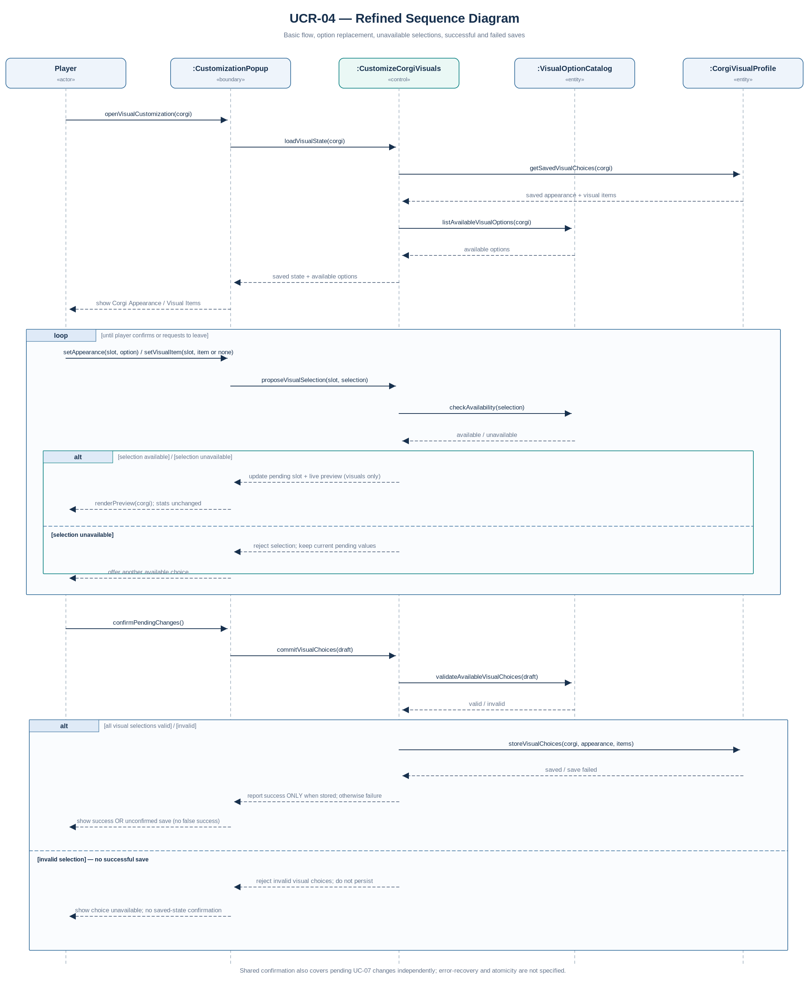
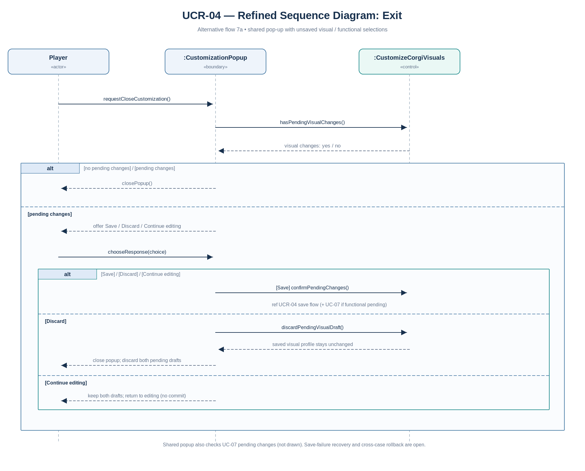

# UCR-04 Corgi Customization — Use-Case Realization

| Author | Realizes |
| --- | --- |
| Tony | [UC-04 Corgi Customization](../use_cases/UC-04_Corgi_Customization.md) |

## 1 Introduction

This realization describes how the system loads, previews, validates and saves the selected Corgi's visual appearance and decorative items as specified in UC-04. It covers the basic flow (UC-04 steps 1–9) and alternative flows 3a, 5a, 3b/5b, 7a and 8a. It does not define functional equipment management (UC-07), purchasing/unlocking, exact locked-option presentation or save-failure recovery.

## 2 Flow of events — design

### 2.1 Participating objects

| Object | Stereotype | Responsibility |
| --- | --- | --- |
| `:CustomizationPopup` | «boundary» | Presents the shared customization pop-up, receives player requests, renders visual preview and offers Save / Discard / Continue editing when the player leaves with pending changes. |
| `:CustomizeCorgiVisuals` | «control» | Coordinates the UC-04 workflow, manages pending **visual** selections, checks availability and commits visual selections only on successful confirmation. Functional state is not modified by this control. |
| `:VisualOptionCatalog` | «entity» | Represents the visual options and their availability to the player. Availability rules and locked-option presentation remain undefined. |
| `:CorgiVisualProfile` | «entity» | Stores the selected Corgi's persisted body appearance and visual-item loadout, independently of functional equipment and stats. |

**Actor:** `Player` interacts with the boundary only. `:CustomizationPopup` is a **shared** boundary with UC-07; it must take independent pending changes from both areas into account when offering Save / Discard / Continue editing. The `:CustomizeCorgiVisuals` control itself checks and modifies only the visual draft. The following analysis models only the visual workflow of UC-04 and the cross-use-case confirmation/cancellation semantics explicitly stated in its requirements.

**Selection constraints:** The six appearance attributes are fur colour, fur pattern, paw colour, snout colour, eye colour and tail colour. Decorative items can be equipped, replaced or removed in applicable independent visual slots; at most one item occupies each visual slot. Pending changes are previewed, not immediately persisted. No visual selection changes character stats, abilities or functional equipment.

### 2.2 Sequence diagrams

#### Basic flow and visual-option alternatives

#### Leaving with unsaved changes (UC-04 alternative 7a)

The Task-03 diagram using frontend/backend/database remains unchanged in [UC-04, section 4.3](../use_cases/UC-04_Corgi_Customization.md). The diagrams above refine it using analysis-level **boundary**, **control** and **entity** objects. Names are analysis concepts, not prescribed implementation class names; concrete design classes belong to Task 05.

### 2.3 Walkthrough

1. **Open/load (UC-04 steps 1–2):** The Player asks `:CustomizationPopup` to open Visual Customization. `:CustomizeCorgiVisuals` loads the selected Corgi's stored visual profile and the available visual choices from the two entities. The boundary then displays the current appearance and the **Corgi Appearance** / **Visual Items** sub-tabs.
2. **Change and preview (steps 3–6, alternatives 3a/5a):** The Player proposes a body option or equips, replaces or removes a decorative item. The control checks whether the selection is allowed; if so, it updates only that pending visual slot and the boundary renders the live preview. A second selection for the same slot replaces the earlier pending selection; removing an item clears the visual slot. These operations do not affect any functional item, stat or ability.
3. **Unavailable choices (alternatives 3b/5b):** When the option is unavailable, the control rejects the proposal and the pending selection remains unchanged. The Player may choose another option. No specific locked-item presentation is assumed.
4. **Confirm/save (steps 7–9):** Upon confirmation, the control validates pending visual selections and asks `:CorgiVisualProfile` to persist the selected Corgi's appearance and decorative items. Success is reported only after a successful save. When functional changes are also pending, the **same shared confirmation** must apply to UC-07 independently; the functional workflow and the inter-workflow failure/atomicity rules are not specified here.
5. **Exit with unsaved changes (alternative 7a):** When the Player tries to close the shared pop-up, the system checks pending changes across **both** areas. If changes exist, it offers Save (use the confirmation flow), Discard (discard both pending drafts without modifying saved data) or Continue editing (retain both drafts in the pop-up). If nothing is pending, the pop-up can close normally.
6. **Failed save (alternative 8a):** The boundary does not show a successful save. The exact error display, retry procedure, draft retention and cross-use-case rollback policy remain undecided rather than being invented in the diagrams.

### 2.4 State machine

Not applicable. The use case does not currently define a durable lifecycle state (such as `approved`/`cancelled`) for a visual profile; **saved vs. pending** refers to the working copy versus persistent data, not to a defined entity state machine. This can be revisited if explicit lifecycle states are added.

## 3 Derived requirements

**None.** The realization makes explicit the existing UC-04 requirements (independent visual persistence, slot replacement, pending preview, shared confirmation and cancellation) without adding new design obligations. These points still need team decisions before implementation:

- How unavailable or locked visual choices are displayed and which ownership/unlock rules apply.
- What recovery action, if any, is offered after a failed save.
- Whether saving simultaneous UC-04 and UC-07 changes is atomic, or how partial failures are handled.

These are **open decisions**, not new confirmed requirements.
