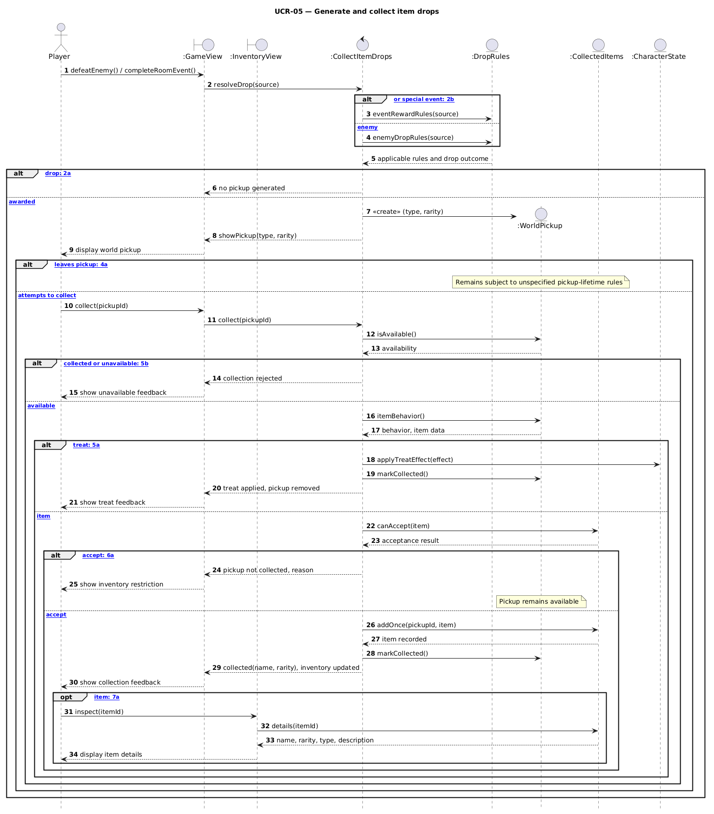
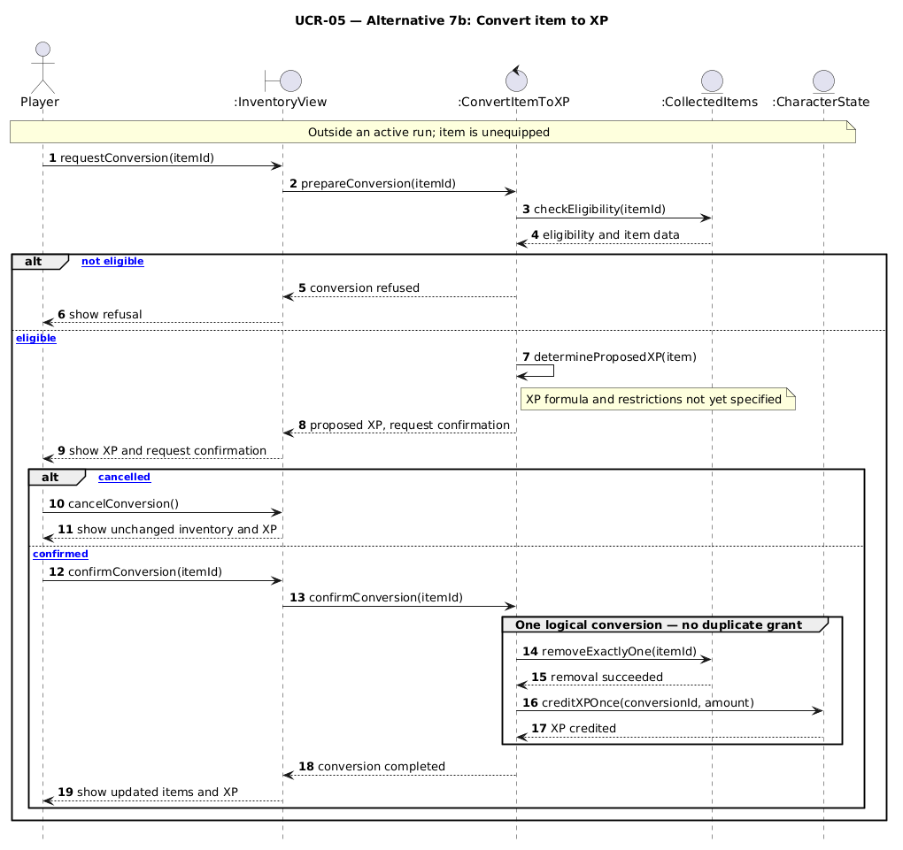
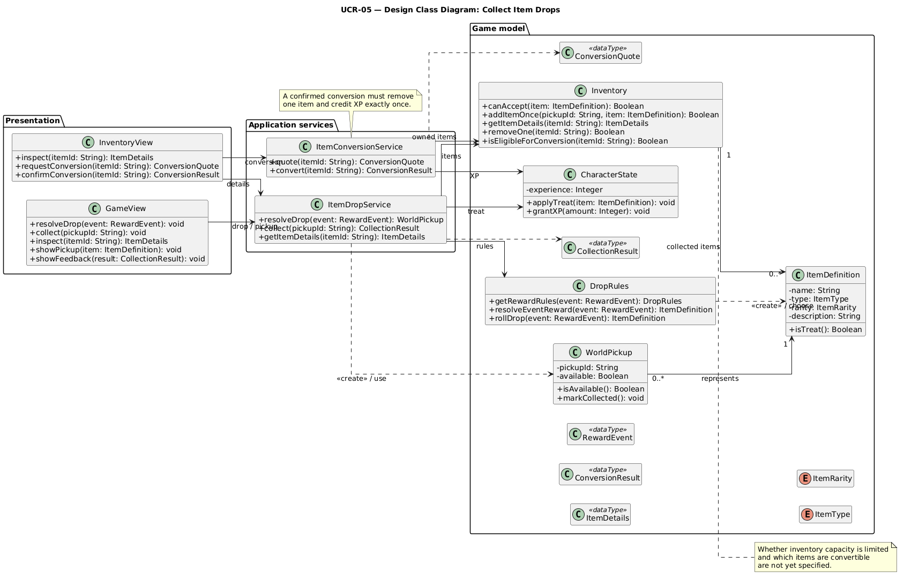
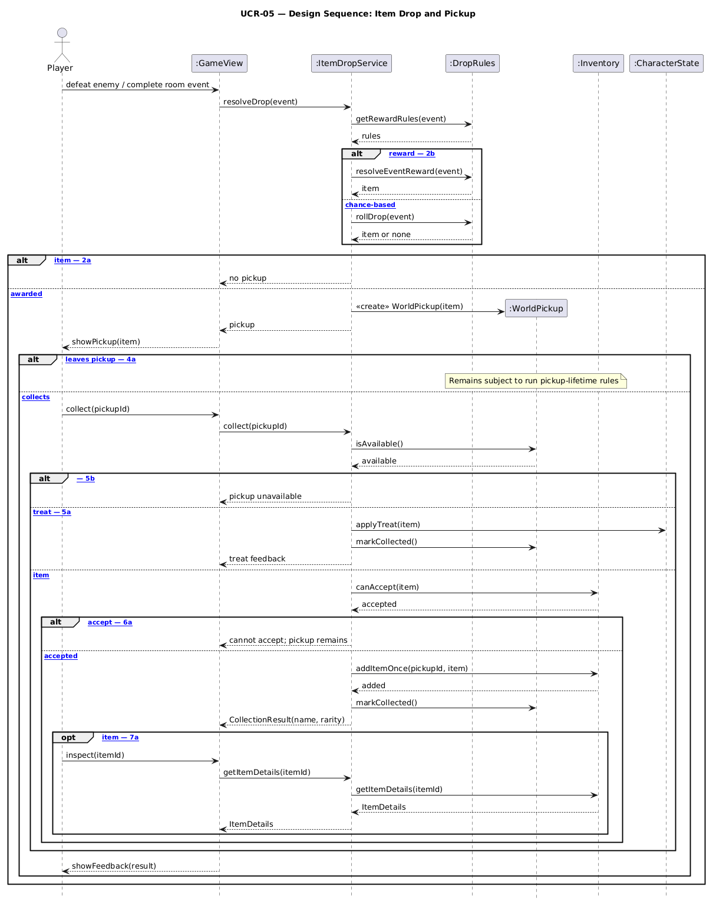
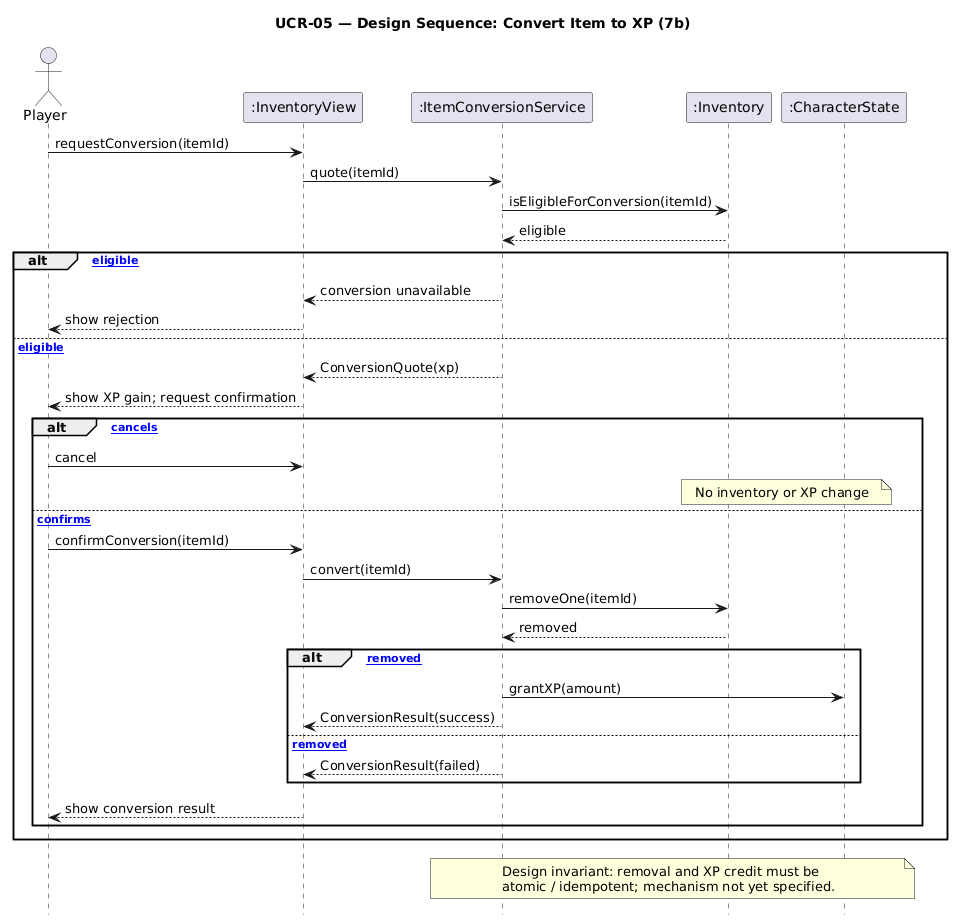

# UCR-05 Collect Item Drops — Use-Case Realization

| Author | Realizes |
| ------ | -------- |
| Kilian Lenz | [UC-05 Collect Item Drops](../use_cases/UC-05_Item_System.md) |

## 1 Introduction

This use-case realization describes how the game coordinates item-drop generation and the collection of pickups in **UC-05 Collect Item Drops**. It covers the basic flow and alternative flows 2a, 2b, 4a, 5a, 5b, 6a and 7a. The out-of-run conversion of an unwanted item into experience (7b) is shown in a separate sequence diagram for readability.

## 2 Flow of events — design

### 2.1 Participating objects

| Object | Stereotype | Responsibility |
| ------ | ---------- | -------------- |
| `:GameView` | `boundary` | Receives in-run actions from the player, displays drops and collection feedback. |
| `:InventoryView` | `boundary` | Displays collected item details and receives out-of-run conversion requests and confirmation. |
| `:CollectItemDrops` | `control` | Coordinates drop resolution, pickup validation, the grant of items or treats, and collection feedback. |
| `:ConvertItemToXP` | `control` | Coordinates the optional out-of-run item-to-XP conversion and its confirmation. |
| `:DropRules` | `entity` | Provides applicable enemy or event reward rules, including item type and rarity. |
| `:WorldPickup` | `entity` | Represents an item spawned in the world and records whether it is still available. |
| `:CollectedItems` | `entity` | Stores the collected items, their properties, and whether an inventory item can be accepted. |
| `:CharacterState` | `entity` | Holds active temporary treat effects and the experience balance. |

### 2.2 Sequence diagrams

**Main flow and in-run alternatives (steps 1–7; 2a, 2b, 4a, 5a, 5b, 6a, 7a)**

PlantUML source: [`UCR-05_sequence.puml`](../diagrams/UCR-05_sequence.puml)

**Alternative 7b: convert an unwanted item to experience outside a run**

PlantUML source: [`UCR-05_conversion_sequence.puml`](../diagrams/UCR-05_conversion_sequence.puml)

### 2.3 Walkthrough

At step **1**, the player defeats an enemy or finishes an eligible room event. The `:GameView` reports the event to `:CollectItemDrops`. At step **2**, the control obtains the appropriate rules from `:DropRules`. The **2b** branch uses event-specific reward rules. **2a** ends the flow when no pickup is awarded. Otherwise the control creates a `:WorldPickup`, which the `:GameView` displays (step **3**).

At step **4**, the player can approach and collect the pickup. If the player leaves it, alternative **4a** ends this interaction without modifying the inventory and the world pickup remains subject to the as-yet-unspecified lifetime rules. On a collection attempt, `:CollectItemDrops` checks `:WorldPickup` availability (step **5**). Alternative **5b** rejects an unavailable/already-collected pickup so it cannot be granted twice. For a temporary treat (**5a**), the control applies the defined effect to `:CharacterState`, consumes the world pickup and sends feedback without adding inventory equipment.

For an ordinary item, the control asks `:CollectedItems` whether the item can be accepted. In **6a**, a refusal leaves the world pickup available and informs the player. Otherwise the collected item is recorded **once** and the world pickup is marked collected (step **6**). The `:GameView` displays the item's name and rarity and updates the inventory indication (step **7**). In optional **7a**, the player asks `:InventoryView` for the item's name, rarity, type and description however no equipment changes occur.

Alternative **7b** takes place **after** the run. The player requests conversion of an eligible unequipped item through `:InventoryView`. `:ConvertItemToXP` checks eligibility and obtains the proposed XP value, then asks for confirmation. Cancellation makes no changes. Confirmation removes exactly one item unit from `:CollectedItems` and credits the corresponding XP to `:CharacterState` exactly once.

### 2.4 State machine

The pickup-lifetime/despawn rules have not yet been specified.

### 2.5 Design classes

| Analysis object (section 2.1) | Design class(es) | Responsibility |
| --- | --- | --- |
| `:GameView` «boundary» | `GameView` | Receives gameplay events and pickup requests, presents results. |
| `:InventoryView` «boundary» | `InventoryView` | Shows item details and requests conversion/confirmation. |
| `:CollectItemDrops` «control» | `ItemDropService` | Resolves drops, validates pickups, and grants items or treats. |
| `:ConvertItemToXP` «control» | `ItemConversionService` | Previews and carries out confirmed XP conversions. |
| `:DropRules` «entity» | `DropRules`, `ItemDefinition` | Evaluates reward rules and describes the resulting item. |
| `:WorldPickup` «entity» | `WorldPickup` | Tracks the availability of a spawned pickup. |
| `:CollectedItems` «entity» | `Inventory`, `ItemDefinition` | Stores collected item definitions and controls addition/removal. |
| `:CharacterState` «entity» | `CharacterState` | Holds active treat effects and accumulated experience. |

**Design class diagram**

Source: [`UCR-05_classes.puml`](../diagrams/UCR-05_classes.puml)

**Redrawn sequence diagram — drop and pickup (design classes)**

Source: [`UCR-05_sequence_design.puml`](../diagrams/UCR-05_sequence_design.puml)

**Redrawn sequence diagram — optional XP conversion (7b)**

Source: [`UCR-05_conversion_sequence_design.puml`](../diagrams/UCR-05_conversion_sequence_design.puml)

## 3 Derived requirements

None at present. UC-05 already specifies NFR-IS-01 (one drop decision per opportunity), NFR-IS-02 (no duplicate pickup grants), NFR-IS-03 (collection feedback target) and NFR-IS-04 (safe, confirmed XP conversion). These should be maintained during implementation. The capacity limit, pickup despawn timing, conversion amounts and eligibility restrictions remain open design decisions.
