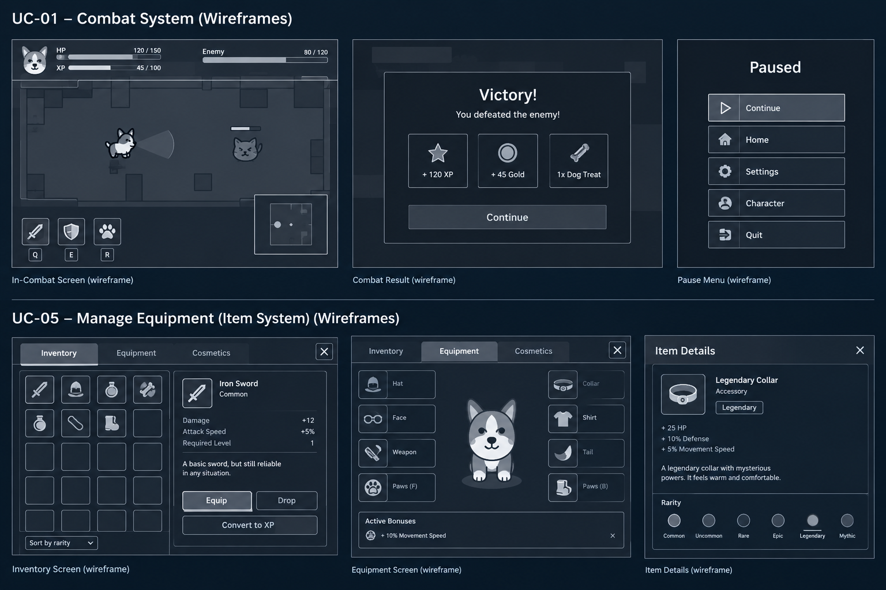
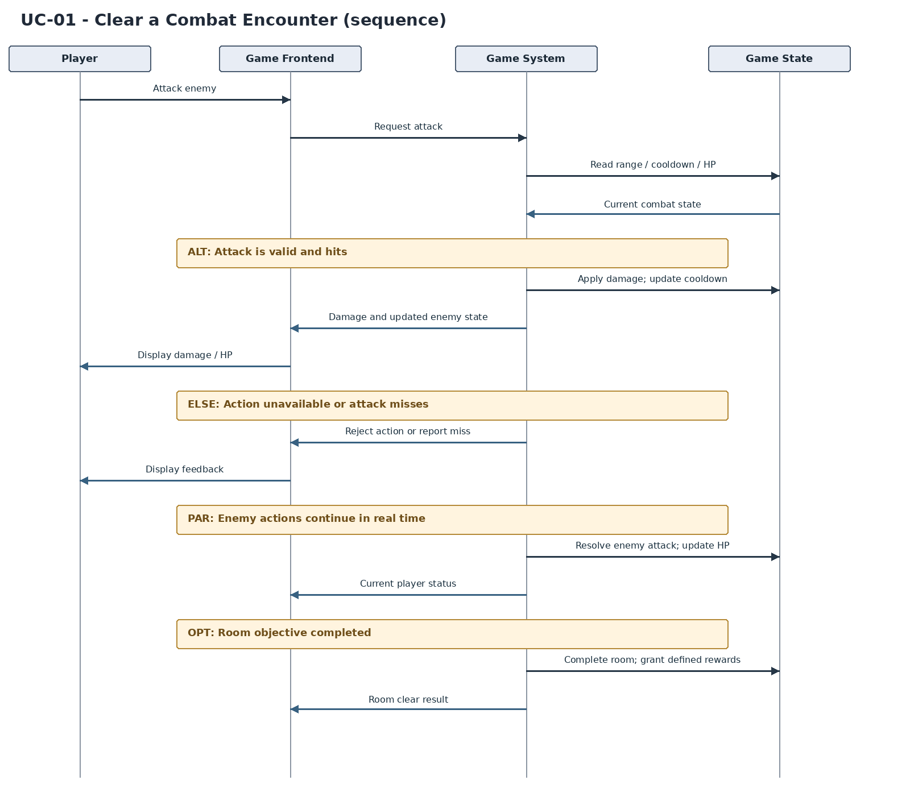

# UC-01 Clear a Combat Encounter

| Author      | Estimate | User stories                                                                                                                                                                                            |
| ----------- | -------- | ------------------------------------------------------------------------------------------------------------------------------------------------------------------------------------------------------- |
| MIGHTYCorgi | 13 SP    | [US-CS-01](https://github.com/xniklasx-dev/MIGHTYCorgi/issues/26), [US-CS-02](https://github.com/xniklasx-dev/MIGHTYCorgi/issues/27), [US-CS-03](https://github.com/xniklasx-dev/MIGHTYCorgi/issues/28) |

## 1 Brief description

In this use case, the player controls a Corgi during real-time combat against enemies in a room-based roguelike. The player can move, perform melee or ranged attacks depending on the equipped weapon, dash, and use class abilities when their cooldowns permit. The system processes collisions, damage, health changes, cooldowns, and defeats. The encounter ends when its victory condition is met or the Corgi is defeated. Successful encounters may award experience and items, depending on the room's reward rules.

## 2 Actors

- **Primary:** Player
- **Secondary:** None

## 3 Mockup

## 4 Flow of events

### 4.1 Basic flow

1. The player enters an active combat room with a living Corgi.
2. The system displays the Corgi's health, available combat actions, ability cooldowns, and the enemies present in the room.
3. The player moves and issues an attack toward an enemy while the enemies act independently in real time.
4. The system checks whether the attack is permitted (e.g., applicable cooldown or range) and resolves any resulting hit and damage.
5. The system updates enemy health, the relevant cooldowns, and the combat feedback displayed to the player.
6. The enemies continue moving or attacking; the system checks hits against the Corgi and updates the Corgi's health accordingly.
7. The player continues attacking, moving, dashing, or using abilities while the encounter remains active; steps 3–6 repeat as actions occur.
8. Once the room's combat objective is met, the system ends the encounter, provides any defined rewards, and enables the next progression step.

### 4.2 Alternative flows

**4a · Attack unavailable.** At step 4, an action is on cooldown or another required condition is not met. The system does not execute the action and communicates that it is unavailable. The flow returns to step 3 while combat continues.

**4b · Attack misses.** At step 4, the attack does not hit an enemy. No damage is applied; the flow continues at step 5.

**3a · Use ability.** At step 3 or 7, the player activates an available ability (`Q`, `E`, or `R`). The system checks its cooldown, applies its effect, starts the appropriate cooldown, and resumes step 5. If unavailable, follow 4a.

**3b · Dash.** At step 3 or 7, the player requests a dash (`Space`). If the dash cooldown permits, the system performs it and updates the cooldown; otherwise, it follows 4a. Combat continues.

**5a · Enemy defeated.** At step 5, an enemy reaches zero health. The system removes that enemy from active combat, requests any applicable item-drop resolution (see UC-05), and checks whether the room objective has been completed. If other required enemies/objectives remain, the flow continues at step 6; otherwise, it continues at step 8.

**6a · Player defeated.** At step 6, the Corgi reaches zero health. The system ends the encounter and run, and displays the death screen and run statistics. The use case ends without a successful room-clear result.

**7a · Temporary treat boost.** During step 7, the player collects a dropped treat, if available (see UC-05). The system applies its specified temporary effect, such as a damage or movement-speed boost, and combat continues.

### 4.3 Sequence diagram

## 5 Special requirements

- **NFR-CS-01 — Responsiveness:** In a defined local performance test, at least 95% of valid player combat actions shall produce visible feedback within **100 ms** of input. _(Proposed target)_
- **NFR-CS-02 — Cooldown visibility:** Each ability or dash with a cooldown shall display either `READY` or its remaining cooldown to a precision of at least **1 second**.
- **NFR-CS-03 — Defeat consistency:** Once a participant reaches **0 HP**, the system shall reject further attacks initiated by that participant for that encounter.
- **NFR-CS-04 — Damage display:** Following every registered damaging hit, the target's displayed HP shall reflect the damage calculation by the **next rendered frame**.

These use-case-specific targets do **not** replace the four system-wide measurable requirements required in SRS sections 3.2–3.5.

## 6 Preconditions

- A valid run is active and the Corgi has more than 0 HP.
- The Corgi has entered a room containing an active enemy encounter.
- The Corgi's current equipment, abilities, health and cooldown states are available to the combat system.

## 7 Postconditions

- **Success:** The room's required combat objective is satisfied; defeated enemies are no longer active, relevant health/cooldown states are updated, and the system applies any defined rewards and unlocks progression.
- **Failure:** The Corgi has 0 HP; the encounter/run ends and the death screen is displayed.
- The system retains all state changes relevant to the current run. Long-term save behavior depends on the game's still-to-be-defined save design.
