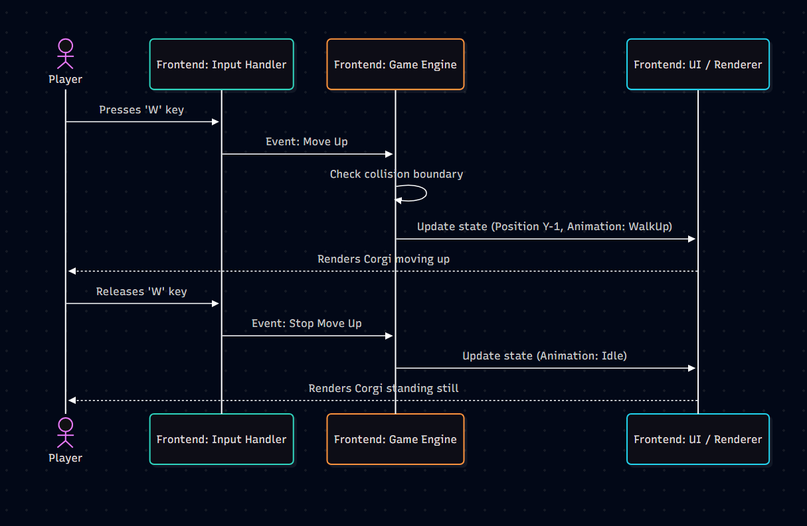
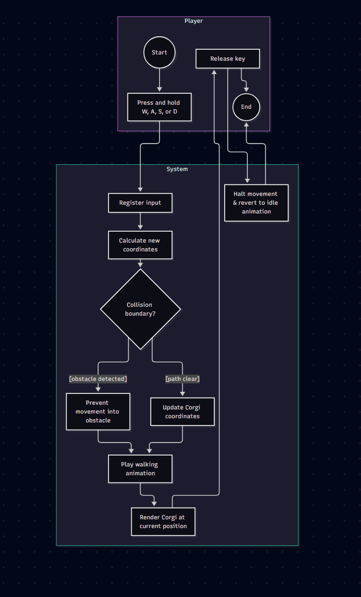

# UC-02 Move the Corgi

| Author  | Estimate | User stories | Realization
| ------- | -------- | -------- | ----------------------------------------------------------------- |
| Andreas | 3 SP     | [US-CM-01](https://github.com/xniklasx-dev/MIGHTYCorgi/issues/18) | [UCR-02](../use_case_realizations/UCR-02_move_the_corgi.md) |

## 1 Brief description

The player uses the WASD keys to navigate the Corgi character through the game world in real-time, allowing exploration of the randomly generated levels.

## 2 Actors

- **Primary:** Player
- **Secondary:** None

## 3 Mockup

## 4 Flow of events

### 4.1 Basic flow

1. The player presses and holds one or more directional keys (W, A, S, D).
2. The system registers the input.
3. The system calculates the new coordinates for the Corgi based on movement speed.
4. The system updates the Corgi's sprite to the corresponding walking animation.
5. The system renders the Corgi at the new position on the screen.
6. The player releases the key(s).
7. The system halts the movement and reverts the sprite to the idle animation.

### 4.2 Alternative flows

**3a. Collision with an obstacle (Wall/Enemy):**

1. The system calculates the new coordinates and detects a collision boundary.
2. The system prevents movement into the blocked coordinates.
3. The Corgi sprite plays the walking animation but remains in place (sliding against the wall).
4. The flow continues at step 6 when the key is released.

### 4.3 Sequence diagram

### 4.4 Activity diagram

## 5 Special requirements

The movement input must be registered and reflected on the screen with a maximum latency of 16 milliseconds (targeting 60 FPS) to ensure tight and responsive controls (Performance requirement).

## 6 Preconditions

A game session (run) is active, and the player's Corgi is spawned inside a playable level. No menus are currently blocking the screen.

## 7 Postconditions

The Corgi is located at the new coordinates within the game world.
