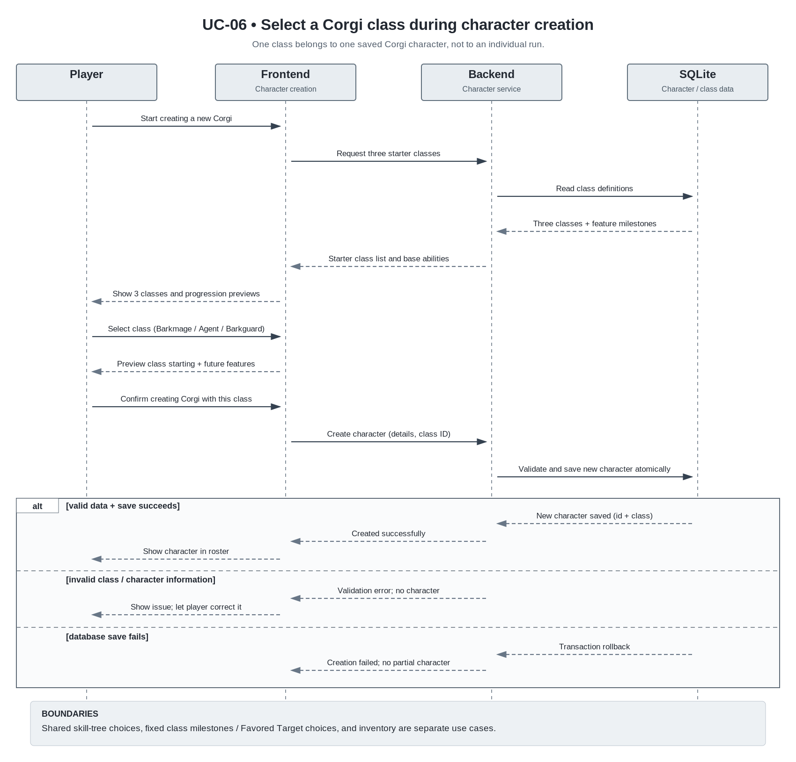

# UC-03 Select a Corgi class

| Author | Estimate | User stories                                                                                                                                                                                               |
| ------ | -------- | ---------------------------------------------------------------------------------------------------------------------------------------------------------------------------------------------------------- |
| Niklas | 13 SP    | [US-CCS-01](https://github.com/xniklasx-dev/MIGHTYCorgi/issues/29), [US-CCS-02](https://github.com/xniklasx-dev/MIGHTYCorgi/issues/30), [US-CCS-03](https://github.com/xniklasx-dev/MIGHTYCorgi/issues/31) |

## 1 Brief description

While creating a new Corgi character, the player selects exactly one of three available starting classes. Each class represents a different playstyle and offers unique characteristics that complement the abilities shared by all Corgis. The selection interface allows the player to compare the available classes, view their general descriptions, and choose the class that best matches their preferred playstyle.

The selected class is permanently associated with the newly created Corgi character rather than the player account or an individual run. A player may create and own multiple Corgi characters, each with a different class. This use case ends when the character has been successfully created with the selected class and its initial state has been saved.

**Current example class concepts:**

| Class                              | General concept                                                                        |
| ---------------------------------- | -------------------------------------------------------------------------------------- |
| **Barkmage** (Wizard)              | A magic-focused Corgi specializing in powerful spells and offensive magical abilities. |
| **S.P.A.W. Agent** (Special Agent) | A tactical Corgi specializing in exploiting the weaknesses of specific enemy types.    |
| **Royal Barkguard** (Tank)         | A defensive Corgi focused on survivability, damage reduction, and self-healing.        |

These classes are preliminary example concepts that illustrate the intended variety of playstyles. Their names, abilities, attributes, and other characteristics are subject to change during further development.

The detailed specifications of individual classes, including their abilities, attributes, balancing, and class-specific progression milestones, will be defined in a separate future use case. Character leveling, the shared base Corgi skill tree, and the inventory and item systems are also covered by separate use cases.

This use case focuses exclusively on selecting a class during character creation. Unlocking class-specific features, progressing through character levels, and changing the class of an existing character are outside its scope.

## 2 Actors

- **Primary:** Player — creates a new Corgi character and selects its class.
- **Secondary:** None — the frontend, backend, and SQLite database are internal components of MIGHTYCorgi, not external actors.

## 3 Mockup

Wireframe shows the three starter classes, their initial abilities, later class features, and the confirmation of character creation.

Wireframe shows the three starter classes, their initial abilities, later class features, and the confirmation of character creation.

Wireframe shows the three starter classes, their initial abilities, later class features, and the confirmation of character creation.

## 4 Flow of events

### 4.1 Basic flow

1. The player starts creating a new Corgi character (the player may already own other Corgi characters).
2. The system presents Barkmage, S.P.A.W. Agent, and Royal Barkguard as the three available starter classes, showing their playstyles, initial class features, previews of later class milestones, and the shared base Corgi abilities.
3. The player selects one class for the new character.
4. The system previews how the selected class complements the common Corgi base abilities, distinguishes starting features from later locked features, and indicates that subsequent character level-ups offer common skill-tree choices plus predetermined class features at specified milestones.
5. The player confirms creation of the new character with the selected class and the required character-creation information.
6. The system validates the class and character-creation information, then creates and persists a new character associated with the current player, with exactly one selected class, initial character progression, shared base abilities, and that class's starting features. No other characters are modified.
7. The system confirms successful creation and makes the new character available in the player's character roster, retaining its class for future runs.

### 4.2 Alternative flows

**2a · Class definitions unavailable.** At step 2, the system cannot load the three starter-class definitions. It reports the problem and offers a retry. A retry returns to step 2, otherwise, the use case ends without creating a character.

**3a · Player changes the selection.** At step 3 or 4, the player chooses a different one of the three starter classes. The system updates the preview without creating a character or affecting any existing characters. The flow continues at step 4.

**5a · Creation cancelled.** At step 5 (or earlier), the player exits without confirming character creation. The system discards the pending class selection and new-character draft. No new character is created, existing characters remain unchanged. The use case ends.

**6a · Invalid or unavailable class.** At step 6, the submitted class ID is invalid or the selected class is no longer available due to inconsistent class data. The system rejects character creation, retains all existing characters, and informs the player. The flow returns to step 2 to reload valid classes, no partial character is persisted.

**6b · Invalid character-creation information.** At step 6, required character-creation information is missing or invalid. The system explains what must be corrected, does not create a character, and returns to step 5 with the class selection still shown.

**6c · Persistence failure.** At step 6, storing the new character or its initial class/progression state fails. The system treats the operation as unsuccessful, rolls back the character creation as a unit, reports that no new character was created, and offers a retry at step 5 or cancellation. It must not leave a partially created character or change any previously existing character.

### 4.3 Sequence diagram

## 5 Special requirements

- **NFR-CCS-01 — Class-selection usability:** At least 8 of 10 first-time players shall be able to identify the three available classes, select one, and complete character creation within 2 minutes without assistance, assuming all other required character-creation information is provided.
- **NFR-CCS-02 — Character-class persistence:** In 100 of 100 controlled restart tests after a successful character creation, the newly created character shall retain the same class association. In the same tests, any previously existing characters shall retain their original class associations.
- **NFR-CCS-03 — Consistent creation:** In 100 of 100 controlled tests in which persistence fails during character creation, the system shall leave no partially created character and shall not change any existing character's class or progression state.

## 6 Preconditions

- The player is in the new-character creation flow.
- The system supports a player owning multiple distinct Corgi characters and associates each created character with its owning player.
- The three starter classes Barkmage, S.P.A.W. Agent, and Royal Barkguard are configured as selectable options.
- The common base Corgi abilities and base skill tree are defined independently from the class definitions.
- Initial class features and later fixed character-level milestones are defined or at least identifiable in each class's data, so that the selection screen can show accurate starting features and future progression previews.

## 7 Postconditions

- **Successful creation:** One new Corgi character exists for the player with the selected class chosen from the three starter classes.
- **Class persistence:** The class is stored on that character and persists across future runs.
- **Initial abilities and progression:** The new character receives the shared base Corgi abilities and its class's starting features. Later class features remain locked until the separate progression logic unlocks them at the applicable character-level milestones.
- **Shared skill tree:** The new character has an initial state for the shared base skill tree and its own progression. The player will make base skill-tree choices at future character level-ups in the separate level-up/skill-tree use case.
- **Existing characters:** Other Corgi characters belonging to the same player, including their classes, progression and inventories, remain unchanged.
- **Character roster:** The new character appears in the player's character roster and can be selected for future gameplay.
- **Cancellation or failure:** No new character is committed and no partially created character remains.
- **Unchanged state on cancellation or failure:** The player's existing characters and their classes, progression, skills, and inventory state are unchanged.
