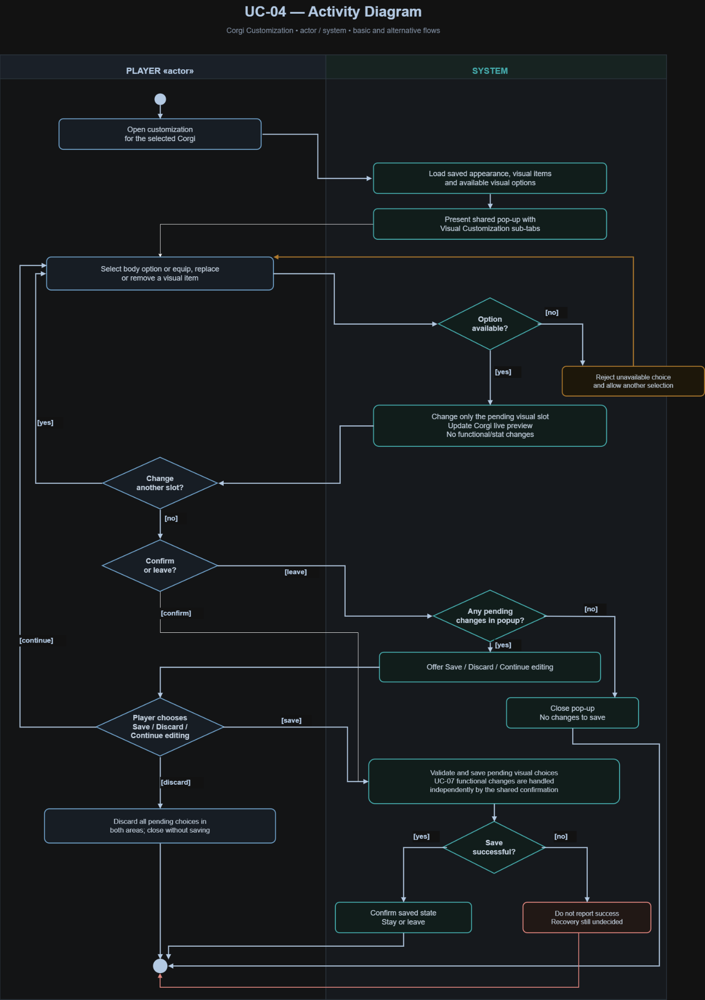

# UC-04 Corgi Customization

| Author | Estimate | User stories |
| --- | --- | --- |
| Tony | To be estimated | [US-04-01](../../user_stories/US-04-01_open_visual_customization.md), [US-04-02](../../user_stories/US-04-02_customize_corgi_appearance.md), [US-04-03](../../user_stories/US-04-03_equip_visual_items.md), [US-04-04](../../user_stories/US-04-04_save_visual_customizations.md), [US-04-05](../../user_stories/US-04-05_handle_unsaved_visual_changes.md)

**Realization:** [UCR-04 — Corgi Customization](../use_case_realizations/UCR-04_Corgi_Customization.md)

## 1 Brief description

Outside a run, the player can customize the visible appearance of the currently selected Corgi using the **Customization (Items / Visuals)** entry on the Character Screen. This use case covers the **Visual Customization** area of a single pop-up. It contains two sub-tabs: Corgi Appearance, where the player can change fur colour, fur pattern, paw colour, snout colour, eye colour and tail colour, and Visual Items, where the player can equip, replace and remove decorative items in applicable categories, such as collars, hats, face accessories, clothing and other displayed equipment.

The chosen body attributes and visual items are shown on the Corgi in a live preview, but never modify its stats, abilities or functional equipment. Visual item slots are independent of similarly named functional equipment slots: a visible hat, for example, need not match the stat-affecting hat equipped under UC-07 Manage Equipmen. The player explicitly confirms the pending changes. On success, the saved appearance persists between game sessions. The Save / Discard controls belong to the shared pop-up: when both UC-04 and UC-07 have pending selections, the same confirmation handles both independent sets rather than silently discarding one of them. If the player leaves with unsaved changes, the system offers Save, Discard and Continue editing. Obtaining or purchasing cosmetic options is outside this use case.

## 2 Actors

- **Primary:** Player — changes the selected Corgi's body appearance and displayed decorative items.
- **Secondary:** None.

## 3 Mockup

*Visual Customization → Corgi Appearance: the Corgi preview changes, but its stats do not.*

*Visual Customization → Visual Items: displayed equipment is independent of the functional item loadout.*

The two wireframes show two states of the same pop-up, not two separate windows.

## 4 Flow of events

### 4.1 Basic flow

1. The **player**, outside a run with an existing Corgi selected, opens **Customization (Items / Visuals)** on the Character Screen.
2. The **system** opens the pop-up with the Corgi's saved appearance and decorative-item selections and offers **Visual Customization → Corgi Appearance / Visual Items**.
3. The **player** opens **Corgi Appearance** and selects an available option for one of the six body-appearance slots.
4. The **system** updates the unsaved live Corgi preview without changing stats, abilities or functional equipment.
5. The **player** opens **Visual Items** and equips, replaces or removes an available decorative item in a visual slot.
6. The **system** updates the displayed item on the Corgi, leaving functional equipment and resulting stats unchanged. The **player** may repeat steps 3–6 for additional visual selections.
7. The **player** confirms the pending changes in the pop-up.
8. The **system** validates and saves the visual appearance and visual-item loadout separately from functional equipment, then confirms success. If functional changes are also pending, they are saved by the same shared confirmation as described in UC-07; visual changes alone do not modify functional equipment.
9. The **player** stays in the pop-up or returns to the Character Screen.

### 4.2 Alternative flows

**3a · Replace an appearance option.** At step 3, the player chooses a different option for a visual body slot already configured. The system replaces only that slot's pending value and updates the preview. Continue at step 4.

**5a · Replace or remove a visual item.** At step 5, the player selects another item for an occupied visual slot or removes its item. The system updates only the visible Corgi preview, functional equipment and stats remain unchanged. Continue at step 6.

**3b / 5b · Unavailable visual option.** At step 3 or 5, the requested option or item is not available to the player. The system does not accept it as a savable selection and allows another choice. The way locked options are presented has not yet been decided. Return to step 3 or 5.

**7a · Leave with unsaved changes.** Before a successful save, the player attempts to close the pop-up with pending visual changes. The system offers Save, Discard or Continue editing. Save proceeds to step 8. Discard closes the pop-up without saving **any** pending changes in either area; previously saved visual and functional selections are retained. Continue editing preserves all pending selections in the pop-up and returns to step 3 or 5.

**8a · Save fails.** At step 8, saving is unsuccessful and the system does not confirm a successful save. The exact error display, retry and recovery process are still to be decided.

### 4.3 Sequence diagram

### 4.4 Activity diagram

The activity diagram below shows the basic flow and the alternative flows, including unavailable options, replacement/removal, unsaved changes and unsuccessful saves. It separates actions of the player from actions of the system.

## 5 Special requirements

- **NFR-U-CUST-01 (Visual customization usability):** Given an already selected Corgi, an open Character Screen, and available visual options, at least **8 of 10 first-time test players** shall be able to change one body-appearance option, equip one decorative item and save both changes **within 3 minutes without assistance**.
- **NFR-R-CUST-01 (Visual–functional state integrity):** In **10 of 10 controlled tests**, changing and successfully saving visual appearance or a decorative item shall leave the Corgi's functional item selections and resulting stats and abilities unchanged.

## 6 Preconditions

- The player has an existing Corgi selected on the Corgi Crew screen and is on its Character Screen outside a run.
- The **Customization (Items / Visuals)** pop-up is accessible and the Visual Customization area can load that Corgi's saved appearance and visual-item selections.
- At least some basic appearance options are free and available from the beginning; some other options or decorative items may need to be unlocked, collected or bought.
- Available visual-item categories and options can be identified by the system.

## 7 Postconditions

### On success

- The selected Corgi's six body-appearance choices and its visual item loadout are stored as visual selections and persist across game restarts.
- Its displayed appearance reflects only the saved body-appearance choices and visual items.
- Its functional equipment, stats and abilities remain unchanged by this use case.
- A maximum of one visual item occupies each applicable visual slot, the saved functional item in a similarly named slot may be different.
- The system confirms a successful save and permits the player to stay in or leave the pop-up.

### On cancellation or failure

- Choosing **Discard** preserves all previously saved visual and functional selections and their resulting stats, because nothing pending in the shared pop-up is committed.
- Choosing **Continue editing** preserves pending selections in both pop-up areas without committing them.
- A failed save is not reported as successful, but the exact recovery behavior remains undecided.

## Scope and unresolved decisions

- **Covered by UC-07 Manage Equipment instead:** equipping stat-affecting items, checking their effects, and changing functional slots.
- **Outside both use cases:** selecting/creating a Corgi, changing its class, skill-tree progression, starting a run, and acquiring or selling items.
- **To be agreed:** exact decorative-item catalogues and unlocking rules, any visual tail-weapon restrictions, whether acquired items are shared across Corgis, how unavailable options are displayed, and error recovery on save.
