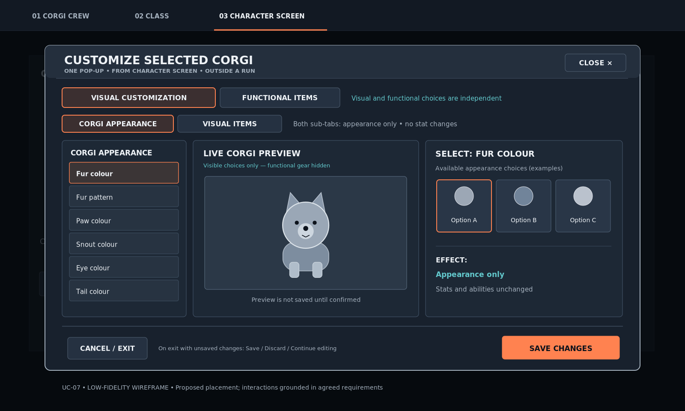
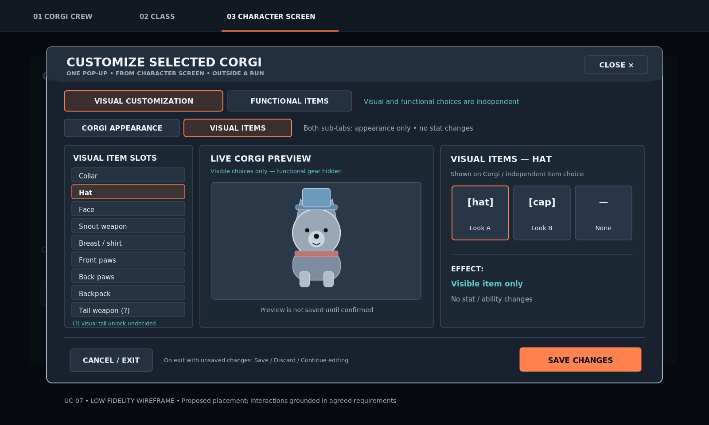
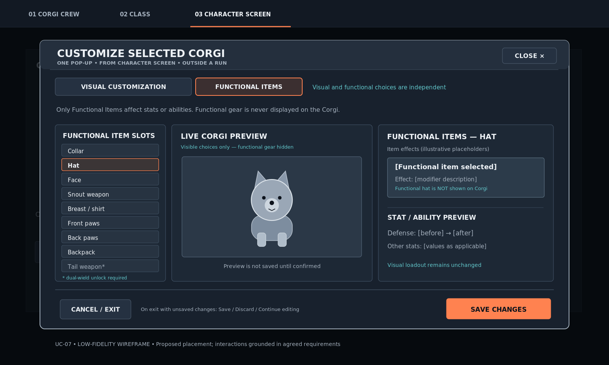
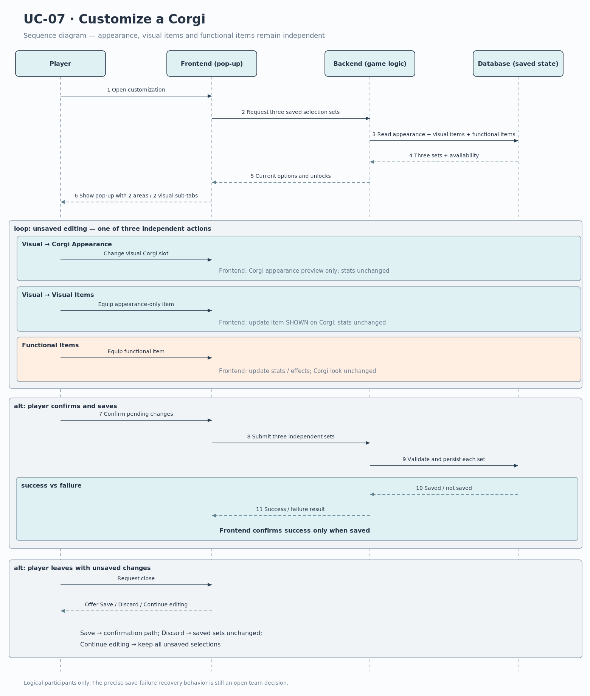

# UC-04 Customize a Corgi

| Author | Estimate | User stories                                                                                                                                                                                                                                                                                                                                                                                                                                                                        |
| ------ | -------- | ----------------------------------------------------------------------------------------------------------------------------------------------------------------------------------------------------------------------------------------------------------------------------------------------------------------------------------------------------------------------------------------------------------------------------------------------------------------------------------- |
| Tony   | 34 SP    | [US-CC-01](https://github.com/xniklasx-dev/MIGHTYCorgi/issues/36), [US-CC-02](https://github.com/xniklasx-dev/MIGHTYCorgi/issues/37), [US-CC-03](https://github.com/xniklasx-dev/MIGHTYCorgi/issues/38), [US-CC-04](https://github.com/xniklasx-dev/MIGHTYCorgi/issues/39), [US-CC-05](https://github.com/xniklasx-dev/MIGHTYCorgi/issues/40), [US-CC-06](https://github.com/xniklasx-dev/MIGHTYCorgi/issues/41), [US-CC-07](https://github.com/xniklasx-dev/MIGHTYCorgi/issues/42) |

## 1 Brief description

Outside a run, the player customizes the currently selected Corgi using **Customization (Items / Visuals)** on the **Character Screen**. The player chooses the Corgi beforehand on the Corgi Crew screen; character selection, class selection, skill-tree progression and starting a run are not part of UC-04. Customization is offered in a single pop-up with **two top-level areas**: **Visual Customization** and **Functional Items**. Visual Customization has **two sub-tabs**: **Corgi Appearance** and **Visual Items**.

In **Corgi Appearance**, the player edits six visual Corgi slots: **fur colour, fur pattern, paw colour, snout colour, eye colour and tail colour**. In **Visual Items**, the player equips, replaces or removes appearance-only items. The visual item slot categories correspond to the item categories (for example collar, hat, face, snout weapon, breast/shirt, front paws, back paws and backpack), but **visual items are independent of functional equipment**. Visual items appear on the Corgi and **never change its stats or abilities**.

In **Functional Items**, the player equips, replaces or removes items that can modify the Corgi's **stats or abilities**. Functional item slots include **collar, hat, face, snout weapon, breast/shirt, front paws, back paws and backpack**. The additional **tail weapon** slot becomes functional only after the relevant dual-wield skill has been unlocked. Functional items **are not drawn on the Corgi**, even when their item category matches a visual slot. The interface shows the functional item's effect description and a preview of resulting stat values. The player's functional loadout therefore does not dictate the Corgi's visible appearance.

The system previews changes before saving: visual changes affect the Corgi preview, whereas functional changes affect the item-effect and stat preview only. The player can equip at most one item per applicable slot. Changes are persisted only upon explicit confirmation, are acknowledged after a successful save and remain after restarting the game. If the player attempts to close the pop-up with unsaved changes, the system offers **Save**, **Discard** or **Continue editing**. The final layout and the exact catalogues/unlock conditions are still subject to team agreement; the wireframes illustrate required interactions, not the final graphics.

## 2 Actors

- **Primary:** Player — adjusts the selected Corgi's appearance and independently equips functional items outside a run.
- **Secondary:** None. The frontend, backend and database are internal components, not external actors.

## 3 Mockup

_State 1 of the same pop-up: **Visual Customization → Corgi Appearance**. Changes affect appearance only._

_State 2 of the same pop-up: **Visual Customization → Visual Items**. The items shown on the Corgi have no stat effects, regardless of functional loadout._

_State 3 of the same pop-up: **Functional Items**. Equipment affects stats or abilities and is **not shown on the Corgi**. The displayed Corgi reflects only the two visual sub-tabs._

## 4 Flow of events

### 4.1 Basic flow

1. The **player** is outside a run with an existing Corgi selected and opens **Customization (Items / Visuals)** on the Character Screen.
2. The **system** opens one pop-up, loads the selected Corgi's saved visual attributes, independently saved visual items and functional items, and shows the **Visual Customization** and **Functional Items** areas. Under Visual Customization, **Corgi Appearance** and **Visual Items** are available as sub-tabs.
3. The **player** opens **Visual Customization → Corgi Appearance** and chooses an available fur colour, fur pattern, paw colour, snout colour, eye colour or tail colour.
4. The **system** shows the changed Corgi appearance in the unsaved live preview, without changing functional equipment, stats or abilities.
5. The **player** opens **Visual Customization → Visual Items** and selects, replaces or removes a visual item in an available category.
6. The **system** previews the selected item's appearance **on the Corgi**, without changing any character stats or abilities and without modifying functional equipment.
7. The **player** opens **Functional Items** and selects, replaces or removes an available functional item.
8. The **system** previews item descriptions and the resulting stat/ability effects **without showing that functional item on the Corgi** and without changing the saved state or any visual selection.
9. The **player** can revisit either area or sub-tab and repeat changes; at most one option or item is selected per applicable slot in each **independent** category set.
10. The **player** confirms the pending changes.
11. The **system** validates the available selections and stores the confirmed Corgi appearance, visual items and functional equipment **as separate sets of data**, applying the effects of functional items only.
12. The **system** confirms a successful save and allows the **player** to remain in the pop-up or return to the Character Screen.

### 4.2 Alternative flows

**3a · Change a previously selected appearance option.** At step 3 or 9, the player chooses another option for an already selected visual Corgi slot. The system replaces only that slot's unsaved appearance selection and updates the visual preview. Return to step 4 or 9.

**5a · Replace or remove a visual item.** At step 5 or 9, the player changes an occupied **visual** item slot or removes the item. Only the item shown on the Corgi changes; character stats, abilities and functional slots are unchanged. Return to step 6 or 9.

**7a · Replace or remove a functional item.** At step 7 or 9, the player replaces an occupied **functional** slot or removes its item. The resulting stat/ability preview is updated, but the Corgi's displayed visual items remain unchanged. Return to step 8 or 9.

**7b · Tail weapon locked.** At step 7, the player tries to use the functional tail-weapon slot without having unlocked the dual-wield skill. The slot cannot be used; the player can select another functional slot. Whether visual tail-weapon cosmetics have the same unlocking condition is **not decided**. Return to step 7.

**3b / 5b / 7c · Unavailable option or item.** An option is not unlocked or the corresponding item is unavailable. The system does not accept the selection as a saved choice and allows the player to choose an available alternative. The precise presentation of locked/unavailable options is undecided. Return to the relevant selection step.

**10a · Leave with unsaved changes.** Before a successful save, the player attempts to close the pop-up. The system offers **Save**, **Discard** or **Continue editing**. Save proceeds to step 11; Discard closes the pop-up without changing any previously saved visual appearance, visual items, functional items, stats or abilities; Continue editing retains all three sets of pending selections and returns to step 9.

**11a · Save unsuccessful.** If saving fails at step 11, the system does not show a success confirmation. Error presentation, retry and recovery behavior remain open team decisions.

### 4.3 Sequence diagram

## 5 Special requirements

- **NFR-CC-01 (Customization completion):** Given a selected Corgi with usable options and the Character Screen already open, at least **8 of 10 first-time test players** shall be able to change one Corgi appearance slot, equip one visual item and one functional item, and save the configuration **within 3 minutes without assistance**. _The expanded three-action test scope should be confirmed with the team._
- **NFR-CC-02 (Effect comprehension):** Given a visible cosmetic item and a functional item with a stat modifier, at least **8 of 10 first-time test players** shall correctly identify that the visual item does not affect stats and identify the stat(s) modified by the functional item, using the descriptions and preview, **without assistance**.

## 6 Preconditions

- An existing Corgi has been selected on the Corgi Crew screen.
- The player is outside a run on that Corgi's Character Screen and can access **Customization (Items / Visuals)**.
- The system can load the selected Corgi's saved appearance choices, visual item selection, functional equipment, inventory/available item choices and slot unlock status.
- Basic free appearance options exist from the beginning; other choices may require unlocking, collection or purchase. The precise availability rules are specified elsewhere or remain open.

## 7 Postconditions

### On success:

- The currently selected Corgi's **appearance attributes**, **visual item loadout** and **functional equipment loadout** are saved independently and persist after closing and restarting the game.
- Appearance attributes and visual items control only the Corgi's visible presentation. A visual item produces **no stat or ability modifier**.
- Functional equipment determines its applicable stat/ability effects but **never changes the Corgi's displayed appearance**. Equipping a functional hat, for example, does not alter the visible hat selected in Visual Items.
- No slot has more than one equipped item in its own visual or functional set. The functional tail-weapon slot remains unavailable until the dual-wield condition is met.
- Functional item effects remain active while those functional items are equipped.
- The system shows a success confirmation, and the player can stay in the pop-up or return to the Character Screen.

### On cancellation or unresolved failure:

- Choosing **Discard** leaves all previously saved appearance choices, visual items, functional equipment, stats and abilities unchanged.
- Choosing **Continue editing** preserves all pending selections in the pop-up without committing them.
- If saving fails, no successful save is reported; further recovery details remain undecided.

## Open decisions and scope boundaries

- **Outside UC-04:** creating/choosing a Corgi, selecting/changing classes, spending skill points, leveling up, buying/obtaining items, converting items to XP and starting a run.
- **Open:** catalogue ownership and sharing between Corgis; exact unlock thresholds, including whether **visual** tail-weapon items have a separate prerequisite; how locked options are displayed; recovery after a failed save; whether quick reset/undo controls exist; and the final UI styling.
- The **two visual sub-tabs** and the **separate Functional Items area** are part of the agreed interaction structure; the wireframes do not fix the final placement of controls.
