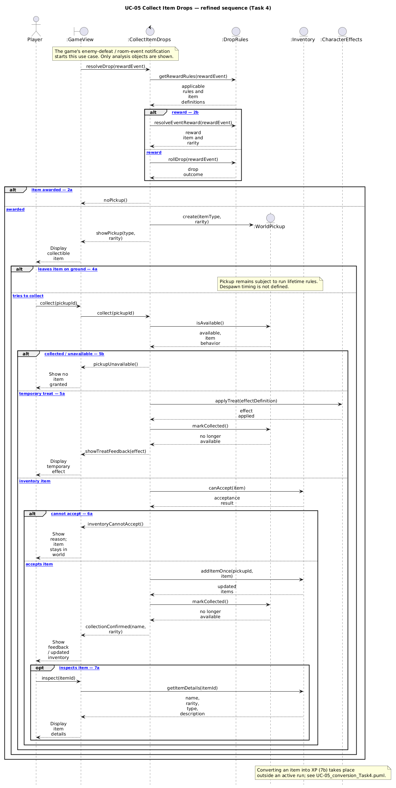
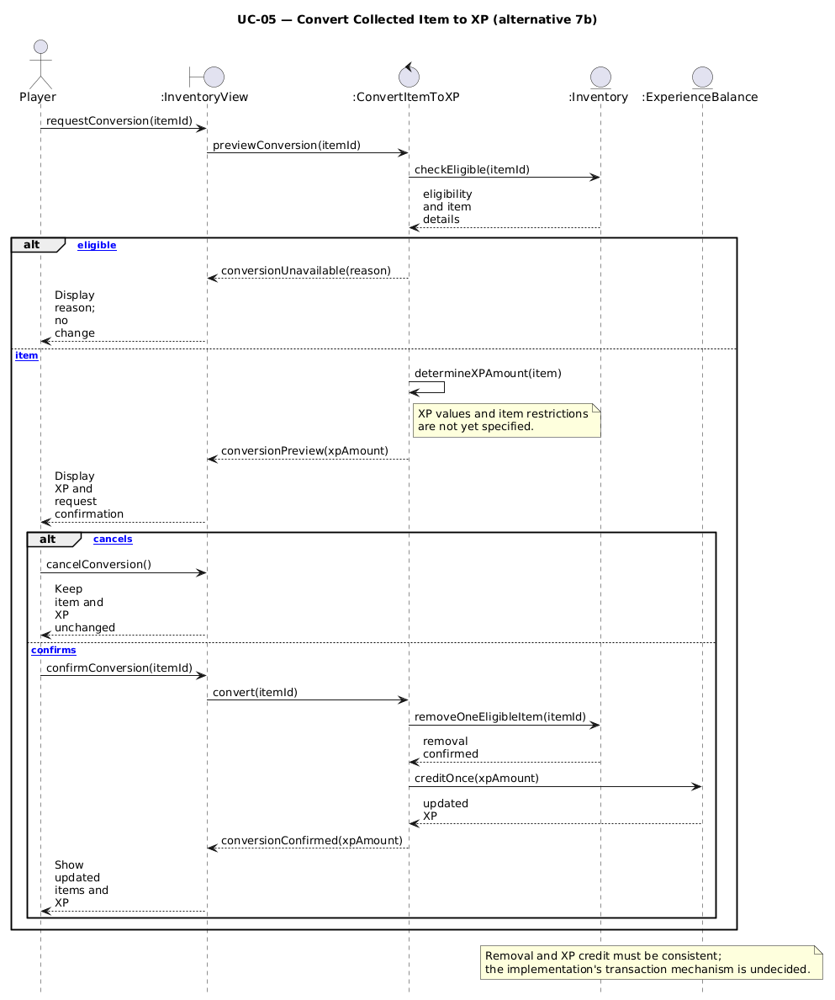
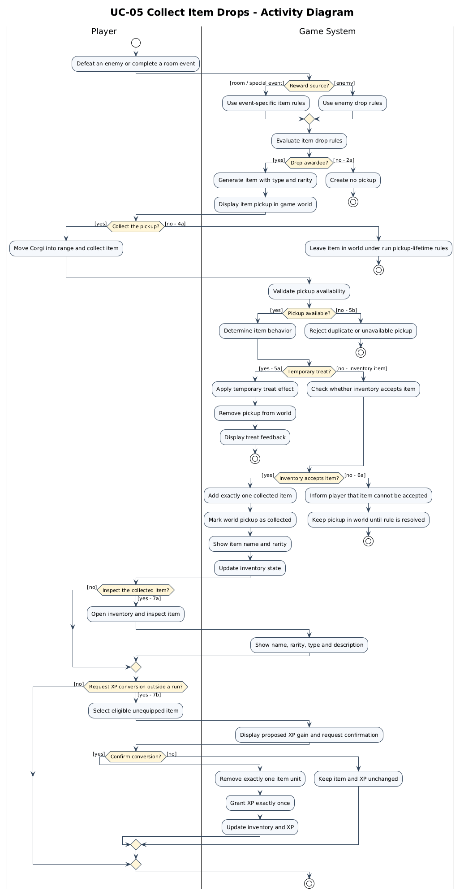

# UC-05 Collect Item Drops

| Author | Estimate | User stories |
| ------ | -------- | ------------ |
| To be assigned | TBD | US-Is01, US-Is02, US-Is03 |

## 1 Brief description

In this use case, the player collects items dropped by defeated enemies or awarded by room events during a room-based roguelike run. The game evaluates the relevant drop chances, creates an item with a defined type and rarity, and presents it as a pickup. When the Corgi collects the item, the system determines whether it grants an immediate temporary treat effect or belongs in the collected-item inventory. Players can inspect the obtained item's name, rarity and description; outside a run, unwanted collected items can be converted into experience. Equipping, swapping and unequipping items belong to a separate use case and are explicitly out of scope.

## 2 Actors

- **Primary:** Player
- **Secondary:** None

## 3 Mockup

Wireframe shows an item on the ground, collection feedback and the obtained-item details. Rarity colors are a gameplay rule; the wireframe itself is grayscale.

## 4 Flow of events

### 4.1 Basic flow

1. During a run, the player defeats an enemy or completes an event that can award an item.
2. The system evaluates the associated item-drop rules and, if the roll succeeds, generates a collectible item with its type and rarity.
3. The system displays the dropped item in the game world with a visual indication of its type or rarity.
4. The player moves the Corgi into pickup range and collects the item.
5. The system validates that the pickup is available and determines the item's defined behavior.
6. For a collectible inventory item, the system adds the item to the player's collected items and marks the world pickup as collected.
7. The system shows collection feedback, including the item's name and rarity, and updates the inventory state.

### 4.2 Alternative flows

**2a · No item drops.** At step 2, the drop roll does not succeed. The system creates no pickup. The use case ends without an inventory change.

**2b · Event-specific drop.** At step 2, a room or special event has a defined reward. The system uses that event's applicable item rules and continues at step 3.

**4a · Pickup not collected.** At step 4, the player leaves the item on the ground. The item remains subject to the run's pickup-lifetime rules. The use case ends without adding the item to the inventory. *Despawn timing has not yet been specified.*

**5a · Temporary treat.** At step 5, the pickup is a temporary treat instead of a persistent inventory item. The system immediately applies its specified effect (for example, regeneration or a temporary attack-speed boost), removes the world pickup, displays feedback and ends the use case. It does not add permanent equipment to the inventory.

**5b · Already collected.** At step 5, the pickup has already been collected or is no longer available. The system does not grant the item a second time and ends the use case.

**6a · Inventory cannot accept the item.** At step 6, the inventory cannot receive the drop under the game's chosen capacity rules. The system informs the player and does not remove the world item until the rule has been resolved. *Whether the inventory has a capacity limit is not yet specified.*

**7a · Inspect item.** After step 7, the player opens the inventory to view the obtained item's name, rarity, type and description. The system displays these properties without changing equipment.

**7b · Convert unwanted item to XP.** Outside an active run, the player selects an eligible unequipped item in the inventory and requests conversion to experience points. The system displays the proposed XP gain and asks for confirmation; upon confirmation it removes exactly one item unit and grants XP once. On cancellation, neither the item nor the XP balance changes. *Conversion amounts and restrictions are not yet defined.*

### 4.3 Sequence diagram

The refined Task 4 sequence diagrams show the basic flow and alternative flows of UC-05. The event-specific reward (2b), no-drop case (2a), ignored pickup (4a), temporary treat (5a), already claimed pickup (5b), inventory refusal (6a), and item inspection (7a) appear in the main diagram. Item-to-XP conversion outside a run (7b) is shown separately for readability.

PlantUML source files: [`UC-05_sequence_Task4.puml`](../diagrams/UC-05_sequence_Task4.puml) and [`UC-05_conversion_Task4.puml`](../diagrams/UC-05_conversion_Task4.puml).

### 4.4 Activity diagram

## 5 Special requirements

- **NFR-IS-01 — Drop consistency:** For 100% of enemy defeat events in an automated test set, no more than one drop decision shall be processed for the same defined drop opportunity.
- **NFR-IS-02 — Pickup consistency:** In 100 consecutive pickup attempts on the same item instance, the inventory item count shall increase by at most one.
- **NFR-IS-03 — Collection feedback:** At least 95% of successful inventory-item pickups shall display the collected item's name and rarity within 250 ms under a defined local performance test. *(Proposed target, not a measured result.)*
- **NFR-IS-04 — Conversion safety:** 100% of item-to-XP conversions shall require confirmation; cancellation shall leave both item count and XP unchanged.

## 6 Preconditions

- A valid run is active for the item-drop-and-pickup main flow.
- The Corgi is alive and can interact with a dropped item.
- Drop rules and item definitions are available to the game system.
- For the conversion alternative, the run has ended and the player has an eligible collected item.

## 7 Postconditions

- **Successful inventory pickup:** Exactly one collected item is added and its world pickup is no longer available; its type and rarity are retained.
- **Temporary treat:** The specified temporary effect is applied and the world pickup disappears without creating permanent equipment.
- **No drop / missed pickup / invalid pickup:** No new item is added to the inventory.
- **Confirmed conversion (optional alternative):** One eligible item is removed and the defined XP gain is applied once.
- Equipping and equipment slot changes do not occur in this use case.

## Linked user stories

### US-Is01 — Generate item drops

**As a** player, **I want** enemies and events to drop items according to their reward rules, **so that** each run offers collectible rewards.

**Acceptance criteria**
1. Given an enemy defeat with a successful drop roll, when the drop resolves, then the system creates a pickup with a valid item type and rarity.
2. Given an unsuccessful drop roll, when it resolves, then no pickup is created for that opportunity.
3. Given one defined drop opportunity, when it is processed repeatedly, then the system does not create duplicate drops from the same resolution.

**Traceability:** Implements UC-05

### US-Is02 — Collect and inspect dropped items

**As a** player, **I want** to pick up dropped items and view their properties, **so that** I know which rewards I obtained.

**Acceptance criteria**
1. Given an available inventory-item pickup, when the Corgi collects it, then exactly one item is added to collected items and the pickup disappears.
2. Given an already collected pickup, when another pickup attempt occurs, then no second item is granted.
3. Given a newly collected item, when the player inspects it, then its name, rarity, type and description are visible.

**Traceability:** Implements UC-05

### US-Is03 — Use treats and recycle unwanted items

**As a** player, **I want** temporary treats to activate when picked up and unwanted collected items to be convertible into XP, **so that** both kinds of drops remain useful.

**Acceptance criteria**
1. Given a temporary treat pickup, when collected, then its defined effect activates and the treat is not added as permanent equipment.
2. Given an eligible collected item outside a run, when conversion is requested, then the system displays the XP gain and asks for confirmation.
3. Given a canceled conversion, then no item or XP balance changes; given a confirmed conversion, exactly one item unit is removed and the specified XP is credited once.

**Traceability:** Implements UC-05